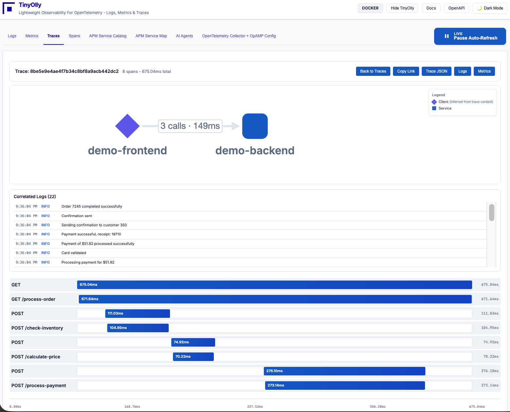
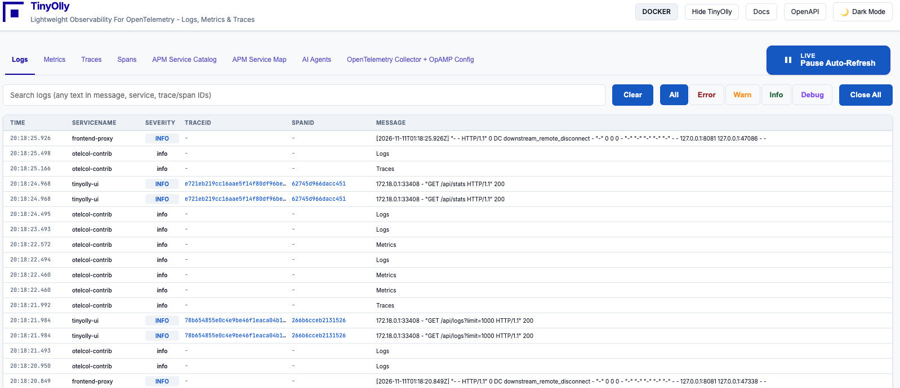
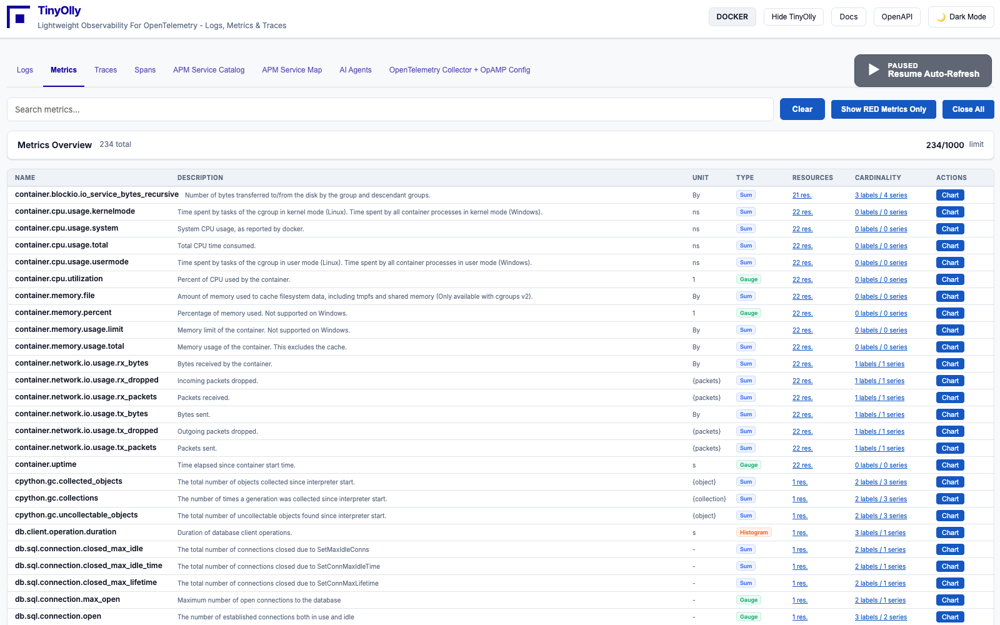
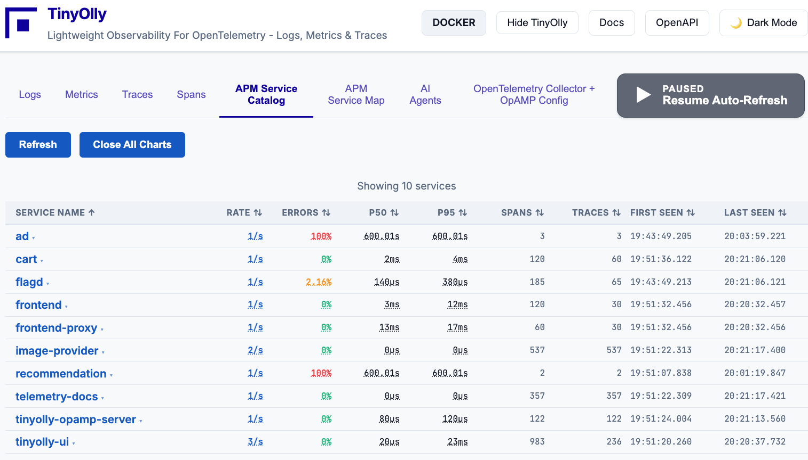
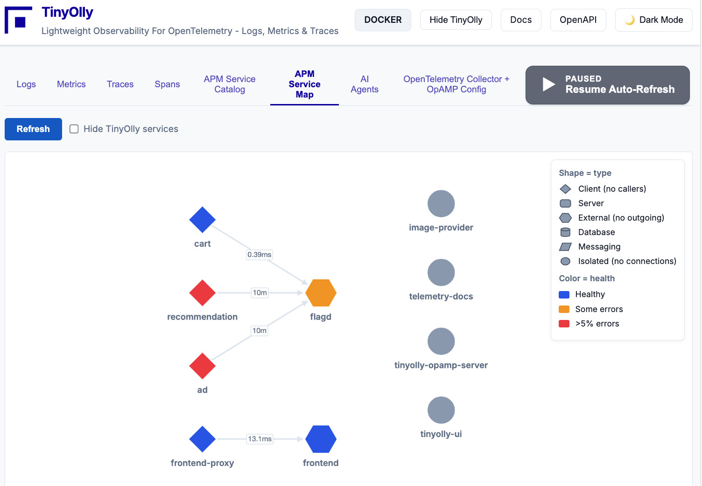
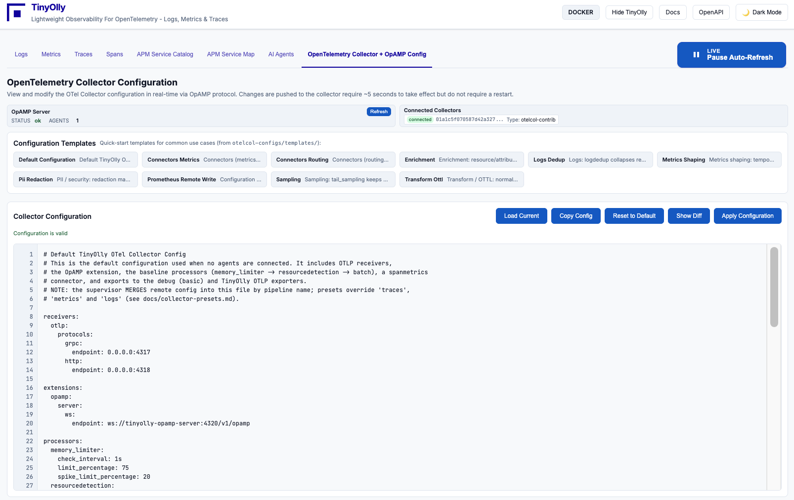

<div align="center">
  
  
  **The World's First Desktop Observability Platform**
</div>

---
## Documentation

Docs are here: [https://tinyolly.github.io/tinyolly/](https://tinyolly.github.io/tinyolly/)  

    

## What is TinyOlly?  

Why send telemetry to a cloud observabilty platform while coding? Why not have one on your desktop?  

TinyOlly is <i>the world's first desktop observability platform</i>: a **lightweight OpenTelemetry-native observability platform** for local development.  
Visualize and correlate logs, metrics, and traces without sending data to the cloud.  

**Key Features:**
- Full OpenTelemetry Protocol (OTLP) support with gRPC and HTTP ingestion
- REST API with OpenAPI documentation
- Service catalog, dependency maps, and distributed tracing
- Per-trace service dependency map (trace map) with inferred external client detection
- Deep linking — shareable URLs that open directly to a specific trace or span
- Click-to-copy trace/span IDs and "Copy Link" buttons for shareable URLs
- Cross-tab log correlation and navigation
- Smart auto-refresh that pauses when search filters are active
- Space-based data retention (keeps data until storage limit; no fixed TTL)
- Works with any OTel Collector distro
- Collector presets applied from the UI via OpAMP: tail sampling, PII redaction, OTTL transforms, enrichment, metrics shaping, log dedup, derived-metric and routing connectors ([docs](docs/collector-presets.md))
- Realistic demo: the upstream OpenTelemetry Demo (Astronomy Shop) with failure-injection flags ([docs](docs/otel-demo.md))
- Built with Python (FastAPI), SQLite, and JavaScript
- Pre-built Docker images available on Docker Hub

**Platform Support:** Docker via Colima, Kubernetes via kind on Colima (Apple Silicon Mac)
**Architectures:** linux/amd64, linux/arm64 (Apple Silicon)

## Screenshots

<div align="center">
  <table>
    <tr>
      <td align="center" width="50%">
        <br>
        <em>Trace waterfall with correlated logs</em>
      </td>
      <td align="center" width="50%">
        <br>
        <em>Real-time logs with trace/span linking</em>
      </td>
    </tr>
    <tr>
      <td align="center" width="50%">
        <br>
        <em>Metrics with chart visualizations</em>
      </td>
      <td align="center" width="50%">
        <br>
        <em>Service catalog with RED metrics</em>
      </td>
    </tr>
    <tr>
      <td align="center" width="50%">
        <br>
        <em>Interactive service dependency map</em>
      </td>
      <td align="center" width="50%">
        <br>
        <em>OpenTelemetry Collector configuration via OpAMP</em>
      </td>
    </tr>
  </table>
</div>

---

## Quick Start

All examples are launched from the repo- clone it first:  
```bash
git clone https://github.com/tinyolly/tinyolly
```  

## Prerequisites (macOS)

TinyOlly uses [Colima](https://github.com/abiosoft/colima) as the container runtime and [kind](https://kind.sigs.k8s.io/) for Kubernetes.

```bash
brew install colima docker docker-compose docker-buildx docker-credential-helper kubectl kind helm
mkdir -p ~/.docker   # let the docker CLI find the compose/buildx plugins:
echo '{"cliPluginsExtraDirs": ["/opt/homebrew/lib/docker/cli-plugins"]}' > ~/.docker/config.json  # (merge into an existing file if you have one)
./scripts/colima-up.sh      # starts the 'tinyolly' Colima VM: 4 CPU / 4 GB by default
```

Override VM sizing with `COLIMA_CPU`, `COLIMA_MEMORY` (GiB) and `COLIMA_DISK` (GiB). On an 8 GB Mac keep the default; on larger machines `COLIMA_MEMORY=8` is more comfortable when running demos. Only one of the Docker stack or the kind cluster should run at a time, since both bind host ports 4317/4318/5005.

**Docker contexts:** Colima creates one Docker context per profile: `colima` (the default VM) and `colima-tinyolly` (this project's VM). All TinyOlly scripts pin themselves to `colima-tinyolly` (override with `COLIMA_PROFILE`), so they work whichever context your shell has active. For your own `docker` commands against the TinyOlly stack, use `docker --context colima-tinyolly ...` or `export DOCKER_CONTEXT=colima-tinyolly`; a plain `docker` uses your active context (`docker context show`), which may be the other VM.

## Docker Deployment

### 1. Deploy TinyOlly Core (Required)

Start the observability backend (pulls pre-built images from Docker Hub):

```bash
cd docker
./01-start-core.sh
```

**Deployment time:** ~30 seconds (pulls images from Docker Hub)

**Services:**
- **OTLP Receiver**: `localhost:4343` (gRPC)
- **OpAMP Server**: `ws://localhost:4320/v1/opamp` (WebSocket), `localhost:4321` (HTTP REST API)
- **UI**: `http://localhost:5005`

- **OTel Collector**: `localhost:4317` (gRPC), `localhost:4318` (HTTP)

**Stop:** `./02-stop-core.sh`

---

### 2. Deploy Demo Apps (Optional)

```bash
cd docker-demo
./01-deploy-demo.sh
```

Two Flask microservices with automatic traffic generation (pulls from Docker Hub). Wait 30 seconds for telemetry to appear.

**For local development:** Use `./01-deploy-demo-local.sh` to build images locally
**Stop:** `./02-cleanup-demo.sh`

---

### 3. eBPF Zero-Code Tracing Demo (Optional)

Deploy a demo showing OpenTelemetry eBPF Instrumentation (OBI) - traces captured at the kernel level with zero code changes (~30 secs deploy):

```bash
cd docker-demo-ebpf
./01-deploy-ebpf-demo.sh
```

This demonstrates:
- **eBPF Agent** captures HTTP traces automatically at kernel level
- **No tracing SDK** in application code - traces come from eBPF
- **Logs & Metrics** still use OTel SDK (shows hybrid approach)

See [eBPF Demo Documentation](docs/ebpf.md) for details on how traces differ from SDK-instrumented apps.

**Stop:** `./02-cleanup.sh`

---

### 5. AI Agent Demo with Ollama (Optional)

Deploy an AI agent demo with zero-code OpenTelemetry auto-instrumentation:

```bash
cd docker-ai-agent-demo
./01-deploy-ai-demo.sh
```

This starts:
- **Ollama** with TinyLlama model for local LLM inference
- **AI Agent** with automatic GenAI span instrumentation via `opentelemetry-instrumentation-ollama`

View AI traces in the **AI Agents** tab - see prompts, responses, token usage (in/out), and latency for each LLM call.

**For local development:** Use `./01-deploy-ai-demo-local.sh` to build locally
**Stop:** `./02-stop-ai-demo.sh`
**Cleanup (remove volumes):** `./03-cleanup-ai-demo.sh`

---

### 6. OpenTelemetry Demo / Astronomy Shop (Optional)

A 16-service subset of the upstream [OpenTelemetry Demo](https://github.com/open-telemetry/opentelemetry-demo) wired to TinyOlly (~1.6 GB of VM memory, fits an 8 GB Mac), with failure-injection flags. Copy-paste to run it end to end:

```bash
# 1. One-time prerequisites (macOS)
brew install colima docker docker-compose docker-buildx docker-credential-helper git
mkdir -p ~/.docker && echo '{"cliPluginsExtraDirs": ["/opt/homebrew/lib/docker/cli-plugins"]}' > ~/.docker/config.json   # merge into an existing file if you have one

# 2. Get TinyOlly and start its Colima VM
git clone https://github.com/tinyolly/tinyolly.git && cd tinyolly
./scripts/colima-up.sh                  # VM 'tinyolly' (Docker context: colima-tinyolly); COLIMA_MEMORY=6 ./scripts/colima-up.sh for more headroom

# 3. Start TinyOlly core (UI :5005, OTLP :4317/:4318)
(cd docker && ./01-start-core.sh)       # use ./01-start-core-local.sh to build from this checkout instead

# 4. Start the OpenTelemetry Demo (first run pulls ~16 images)
cd docker-otel-demo
./01-start-otel-demo.sh                 # clones opentelemetry-demo into .demo/ and starts a 16-service subset

# 5. Use it
open http://localhost:8080              # the shop
open http://localhost:5005              # TinyOlly
./03-set-flag.sh                        # list failure-injection flags
./03-set-flag.sh paymentFailure 50%     # inject failures
./03-set-flag.sh --reset                # turn all flags off

# 6. Stop
./02-stop-otel-demo.sh                  # demo only; add --purge to delete the .demo/ clone
```

**No config edits are needed.** The script clones the demo at the version pinned in `versions.env`, points every service at TinyOlly's collector (`host.docker.internal:4317`) and skips the demo's own collector, Jaeger, Grafana, Prometheus, OpenSearch and Kafka. Options: `LOADGEN=0` (no load generator), `LOCUST_USERS=3`, `SERVICES="..."` (custom service list). Use plain `docker` commands with `--context colima-tinyolly`.

---

### 7. Use TinyOlly with Your Own Apps

Point your OpenTelemetry exporter to:
- **gRPC**: `http://otel-collector:4317`
- **HTTP**: `http://otel-collector:4318`

### 8. Core-Only Deployment (Use Your Own OTel Collector)

```bash
cd docker-core-only
./01-start-core.sh
```

Deploys TinyOlly without the bundled OTel Collector. Includes:
- **OTLP Receiver**: `localhost:4343` (gRPC only)
- **OpAMP Server**: `ws://localhost:4320/v1/opamp` (WebSocket), `localhost:4321` (HTTP REST API)
- **UI**: `http://localhost:5005`

Point your external collector to `localhost:4343` for telemetry ingestion.

## OpAMP Configuration (Optional)

The **OpenTelemetry Collector + OpAMP Config** page in the TinyOlly UI allows you to view and manage collector configurations remotely. To enable this feature, add the OpAMP extension to your collector config:

```yaml
extensions:
  opamp:
    server:
      ws:
        endpoint: ws://localhost:4320/v1/opamp

service:
  extensions: [opamp]
```

The default configuration template (located at `docker/otelcol-configs/config.yaml`) shows a complete example with OTLP receivers, OpAMP extension, batch processing, and spanmetrics connector. Your collector will connect to the OpAMP server and receive configuration updates through the TinyOlly UI.

**Presets:** the Collector tab lists ready-made configs (sampling, PII redaction, transform/OTTL, enrichment, metrics shaping, log dedup, connectors). Each preset overrides the `traces`/`metrics`/`logs` pipelines because the supervisor merges remote config into the base config by name, and takes ~10-30 s to become active. See [Collector presets](docs/collector-presets.md). Validate configs with `./scripts/test-collector-configs.sh`.

**Stop:** `./02-stop-core.sh`

## Kubernetes Deployment

### 1. Deploy TinyOlly Core

```bash
./scripts/colima-up.sh && ./scripts/kind-up.sh
./k8s/02-deploy-tinyolly.sh
```

**Access UI:**
UI available at: `http://localhost:5005` (kind port mapping, no tunnel needed)

**Cleanup:** `./k8s/03-cleanup.sh`

---

### 2. Demo Applications (Optional)

```bash
cd k8s-demo
./02-deploy.sh  # Automatically builds images if needed
```

**Manual image build (optional):** `./build/local/build-demo-kind.sh`
**Cleanup:** `./03-cleanup.sh`

### 3. eBPF Zero-Code Tracing Demo (Optional)

```bash
cd k8s-demo-ebpf
./02-deploy.sh
```

Deploys the eBPF demo with traces captured at the kernel level. Images are pulled from Docker Hub (`tinyolly/ebpf-frontend`, `tinyolly/ebpf-backend`).

See [eBPF Demo Documentation](docs/ebpf.md) for details.

**Cleanup:** `./03-cleanup.sh`

### 4. Core-Only Deployment (Use Your Own OTel Collector)

```bash
cd k8s-core-only
./01-deploy.sh
```

**Cleanup:** `./02-cleanup.sh`

---

## Building Images

For building and publishing Docker images, see [build/README.md](build/README.md).

---

## Features

### UI
- Auto-refresh every 5 seconds (pausable)
- Export JSON with one click
- Service catalog with RED metrics
- Interactive service dependency map
- Distributed trace waterfall with correlated logs
- Metric cardinality protection with visual warnings
- OpAMP-based OpenTelemetry Collector configuration management
- AI Agents tab for GenAI observability

### AI Agents
- View LLM calls with prompts, responses, and token usage
- Zero-code auto-instrumentation via OpenTelemetry GenAI semantic conventions
- Token tracking (input/output) with visual indicators
- Latency monitoring per LLM call
- Click-to-expand JSON span details
- Supports any OpenTelemetry-instrumented LLM (Ollama, OpenAI, etc.)


### Metrics
- Dense, aligned table layout with "Chart" buttons
- Inline "Cardinality" column showing label dimensions and series count
- **Cardinality Explorer**:
    - Deep-dive into metric attributes
    - **Label Analysis**: View high-cardinality labels and their top values (expandable)
    - **Raw Series**: Scrollable view of all active series in PromQL-like syntax
    - **Export**: Copy PromQL or Download JSON for offline analysis

### Service Catalog
- RED metrics (Rate, Errors, Duration) with P50/P95 latencies
- Inline metric visualization
- Sortable columns with persistent filters
- Color-coded error rates

### Service Map
- Auto-detected node types (Client, Server, Database, Messaging)
- Interactive graph with zoom/pan
- Call counts between services
- Real-time topology updates

### Cardinality Protection
- Hard limit of 1000 unique metric names (configurable via `MAX_METRIC_CARDINALITY`)
- Visual warnings at 70% and 90%
- Drops metrics exceeding limit with tracking

### OpenTelemetry Collector + OpAMP Config
- View and manage OpenTelemetry Collector configuration via the OpAMP protocol
- Real-time validation of collector configurations before applying
- Configuration templates for common use cases (default, prometheus-remote-write, etc.)
- View OpAMP server status and connected collector agents
- Apply configuration changes with diff preview
- Requires collector to be connected to the OpAMP server (configured in collector config)

---

## REST API & OpenAPI

Full REST API with OpenAPI 3.0 documentation:
- **Swagger UI**: `http://localhost:5005/docs`
- **ReDoc**: `http://localhost:5005/redoc`
- **OpenAPI Spec**: `http://localhost:5005/openapi.json`

Generate clients in any language:
```bash
curl http://localhost:5005/openapi.json > openapi.json
openapi-generator-cli generate -i openapi.json -g python -o ./tinyolly-client
```

All responses return OpenTelemetry-native JSON with full trace/span context.

## Admin Endpoints
- `GET /admin/stats` - SQLite database size, cardinality, uptime
- `GET/POST/DELETE /admin/alerts` - Alert management
- `GET /health` - Connectivity status

## More

- [Development and testing](docs/development.md)
- [Technical details](docs/development.md#technical-details)

## Licensing

**BSD 3-Clause License** - Free for individual developers, academic use, and small organizations.

**Commercial use** (50+ employees, production deployments, commercial products) requires a license. Contact info in [`LICENSE`](./LICENSE).

---

<div align="center">
  <p>Built for the OpenTelemetry community</p>
  <p>
    <a href="https://github.com/tinyolly/tinyolly">GitHub</a> •
    <a href="https://github.com/tinyolly/tinyolly/issues">Issues</a>
  </p>
</div>
