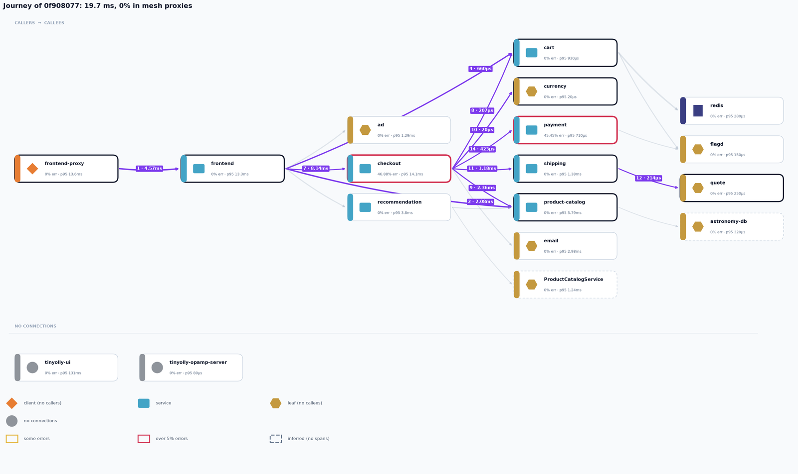
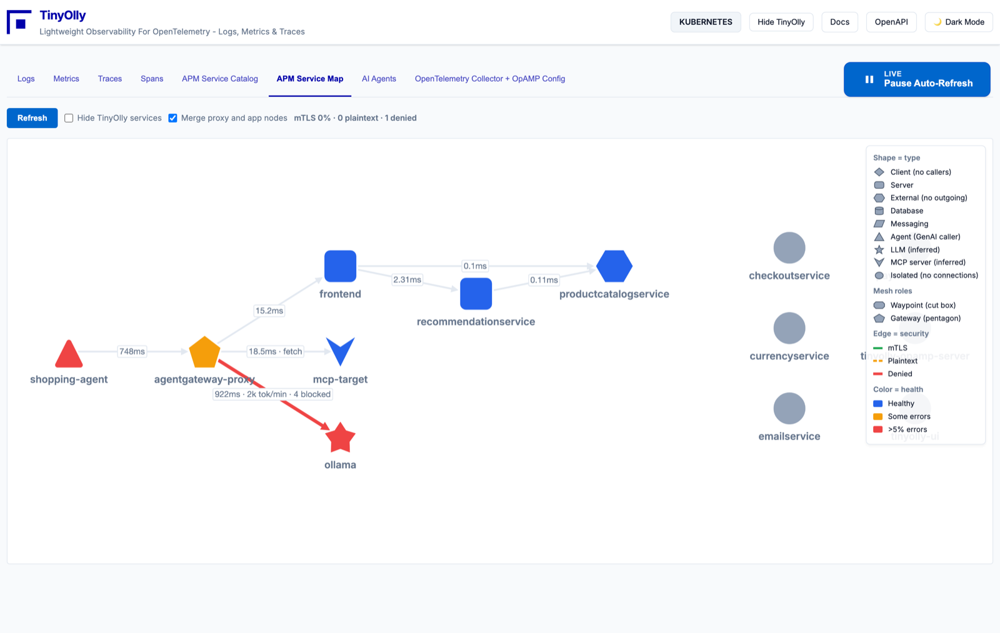
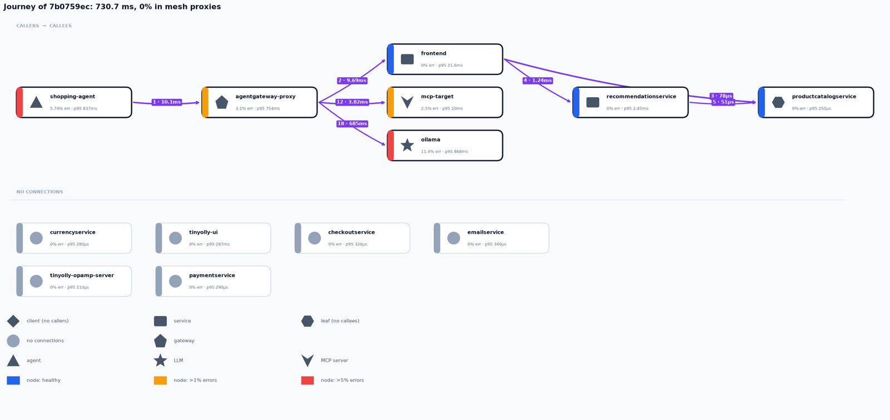

<div align="center">
  

  **The World's First Desktop Observability Platform**

  Ask an AI what is broken. OpenTelemetry logs, metrics and traces on your laptop, with a built-in MCP server.

  
  
  
  

  [Docs](https://tinyolly.github.io/tinyolly/) · [Ask an AI (MCP)](#ask-an-ai-about-your-telemetry-mcp) · [Quick start](#quick-start) · [Teardown](#teardown)
</div>

---

## Ask an AI about your telemetry (MCP)

A read-only [MCP](https://modelcontextprotocol.io) server with **28 tools** and investigation playbooks runs next to the UI. Once TinyOlly is [running](#quick-start), connect an assistant:

```bash
claude mcp add --transport http tinyolly http://127.0.0.1:8765/mcp     # Claude Code
```

Claude Desktop and Zed work too ([connect a client](docs/mcp-deploy.md)). Ask in plain English; it answers from your data and draws charts:

> *"Something is wrong with checkout. What is failing and why?"*
> *"Show me a failing order as a waterfall."*
> *"Which flag changed before payment started failing?"*

<table>
<tr>
<td width="50%" align="center"><a href="docs/images/full/mesh-otel-failure-map.png"></a><br><sub><code>chart_service_map</code>: the failing services in red</sub></td>
<td width="50%" align="center"><a href="docs/images/full/mesh-otel-trace-path.png"></a><br><sub><code>chart_trace_path</code>: one failing order, hop by hop</sub></td>
</tr>
</table>

- **[AI SRE agent](docs/ai-sre.md):** investigates incidents as they happen, using a model on your LAN, Claude or OpenAI.
- **[Agent observability](docs/technical.md#agents-llms-and-mcp-servers):** the service map shows agents, LLMs and MCP servers, with tokens per minute, tool calls and gateway blocks.
- **Tools cover** services, traces, logs, metrics, charts, TinyOlly's docs and Istio mesh checks ([every tool and playbook](docs/mcp.md) · [try it on the OpenTelemetry Demo](docs/otel-demo-ai.md)).

<table>
<tr>
<td width="50%" align="center"><a href="docs/images/full/ui-agent-map.png"></a><br><sub>Agent, gateway, LLM and MCP server on the map</sub></td>
<td width="50%" align="center"><a href="docs/images/full/mesh-agent-trace-path.png"></a><br><sub>One agent run, hop by hop</sub></td>
</tr>
</table>

## Quick start

Apple Silicon Mac with 24 GB or more; TinyOlly runs on [kind](https://kind.sigs.k8s.io/) inside [Colima](https://github.com/abiosoft/colima), no Docker Desktop.

```bash
brew install colima docker kubectl kind helm
git clone https://github.com/tinyolly/tinyolly && cd tinyolly
./scripts/colima-up.sh && ./scripts/kind-up.sh
./k8s/02-deploy-tinyolly.sh             # UI on http://localhost:5005
```

### Add the OpenTelemetry Demo

The Astronomy Shop, a web shop with a load generator, sending to TinyOlly:

```bash
./k8s-otel-demo/01-deploy-otel-demo-helm.sh
kubectl port-forward svc/frontend-proxy 8080:8080     # keep running; shop on http://localhost:8080
```

The first run pulls images for a few minutes, then the service map fills in at http://localhost:5005. Next: [add AI SRE](docs/ai-sre.md) → [break something](docs/scenarios.md).

To send your own telemetry instead, point OTLP at `localhost:4317` (gRPC) or `localhost:4318` (HTTP) ([details](docs/send-telemetry.md)).

> **Local development only.** Not a replacement for a production observability platform.

## Also in the box

Service catalog and map, trace waterfalls with logs, metrics with [cardinality protection](docs/CARDINALITY-PROTECTION.md), [collector presets](docs/collector-presets.md) over OpAMP, [Istio ambient](docs/istio.md) and a [REST API](docs/api.md). Data stays local (SQLite, 30-minute TTL, 256 MB cap).

<a href="docs/images/full/ui-otel-service-map.png"></a>

[UI tour](docs/ui-tour.md) · [Kubernetes](docs/kubernetes.md) · [Architecture](docs/technical.md) · [Development](docs/development.md) · [Release notes](release-notes/)

## Teardown

```bash
scripts/status.sh                          # what is running and how to remove it
scripts/teardown.sh --level vms --prune    # demos, TinyOlly, cluster, VMs, build cache
```

A dry run until you confirm ([more](docs/development.md#tear-everything-down)).

## License

**BSD 3-Clause**: free for individual developers, academic use and small organizations. **Commercial use** (50+ employees, production deployments, commercial products) requires a license; see [`LICENSE`](./LICENSE) and the [licensing page](docs/licensing.md).

---

<div align="center">
  <p>Built for the OpenTelemetry community</p>
  <p>
    <a href="https://github.com/tinyolly/tinyolly">GitHub</a> •
    <a href="https://github.com/tinyolly/tinyolly/issues">Issues</a>
  </p>
</div>
