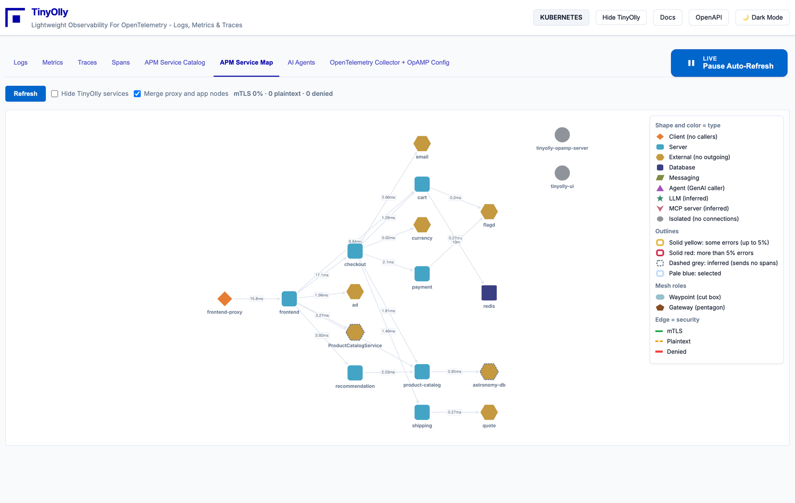
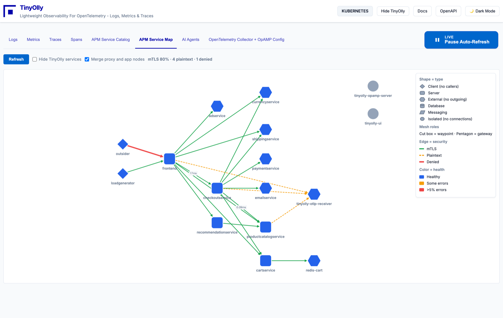
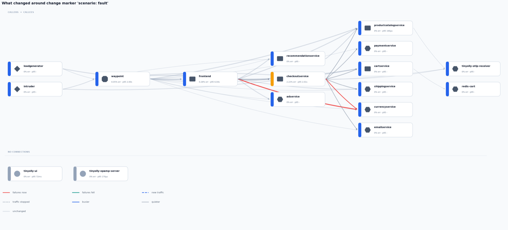
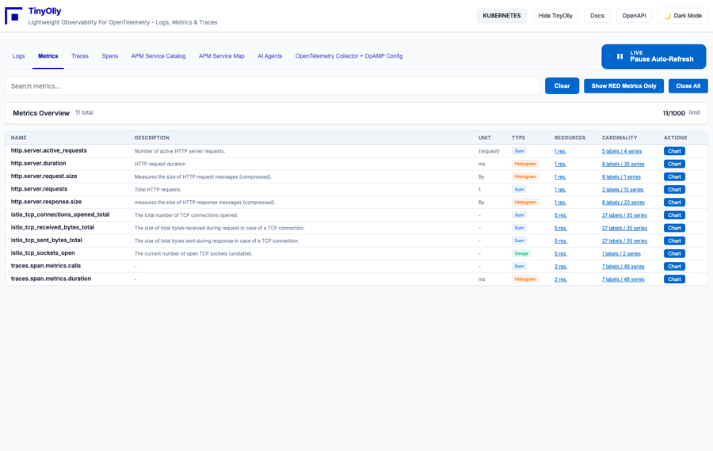

<div align="center">
  

  **The World's First Desktop Observability Platform**

  OpenTelemetry logs, metrics and traces on your laptop, and an AI assistant that can investigate them.

  
  
  
  

  <a href="docs/images/full/ui-otel-service-map.png"></a>

  [Docs](https://tinyolly.github.io/tinyolly/) · [Quick start](#quick-start) · [Demos](#demos) · [Ask an AI (MCP)](#ask-an-ai-about-your-telemetry-mcp) · [Teardown](#quick-teardown)
</div>

---

## Why TinyOlly

Why send telemetry to a cloud platform while you are coding? TinyOlly runs on your Mac, speaks OTLP natively, and gives you the views you would expect from a big platform without the setup.

- **Everything correlated:** service catalog with RED metrics, a service map, trace waterfalls with their logs, a metrics explorer with cardinality analysis. Share a deep link straight to a trace or span.
- **Local and bounded:** no cloud, no accounts. Pre-built images, SQLite storage with a 30-minute TTL and a 256 MB cap, so it never grows out of control.
- **A realistic demo built in:** the official OpenTelemetry Demo with failure injection, and an AI SRE agent that investigates the faults as they happen.
- **AI-ready:** a read-only MCP server with 28 tools and investigation playbooks. Ask Claude Code, Claude Desktop or Zed what is failing and why, and get charts back.
- **Collector control:** apply ready-made collector configs (tail sampling, PII redaction, enrichment) from the UI over OpAMP.
- **No Docker Desktop:** runs on [Colima](https://github.com/abiosoft/colima), with Docker or [kind](https://kind.sigs.k8s.io/) for Kubernetes, on Apple Silicon.

> **Local development only.** TinyOlly is not a replacement for a production observability platform.

## Quick start

About five minutes on a Mac.

```bash
git clone https://github.com/tinyolly/tinyolly && cd tinyolly
brew install colima docker docker-compose docker-buildx docker-credential-helper kubectl kind helm
mkdir -p ~/.docker && echo '{"cliPluginsExtraDirs": ["/opt/homebrew/lib/docker/cli-plugins"]}' > ~/.docker/config.json   # merge into an existing file if you have one

./scripts/colima-up.sh                  # the 'tinyolly' VM, 4 CPU / 4 GB (COLIMA_MEMORY=8 for the demos; sizing applies only when the VM is created, stop it first to resize)
                                        # VM disk lives in ${COLIMA_HOME:-~/.colima}: keep that on APFS, not HFS+ (no sparse files, creation hangs)
(cd docker && ./01-start-core.sh)       # TinyOlly, about 30 seconds
open http://localhost:5005
```

Point your own apps at it with any OpenTelemetry exporter: `http://localhost:4317` (gRPC) or `http://localhost:4318` (HTTP). Containers on the same Docker network use `otel-collector`.

| What | Where |
|---|---|
| UI | `http://localhost:5005` |
| OTLP | `localhost:4317` (gRPC), `localhost:4318` (HTTP) |
| MCP server | `http://localhost:8765/mcp` |

**Prefer Kubernetes?** The same stack on a kind cluster:

```bash
./scripts/colima-up.sh && ./scripts/kind-up.sh
./k8s/02-deploy-tinyolly.sh             # UI on http://localhost:5005, no tunnel needed
```

Run the Docker stack or the kind cluster, not both: they use the same host ports. Details: [Docker](https://tinyolly.github.io/tinyolly/docker/), [Kubernetes](https://tinyolly.github.io/tinyolly/kubernetes/), [Quick start guide](https://tinyolly.github.io/tinyolly/quickstart/).

## Demos

The fastest way to see TinyOlly work: the OpenTelemetry Demo, and an AI SRE agent that watches it.

| Demo | What you see | Run it |
|---|---|---|
| **[OpenTelemetry Demo](docs/otel-demo.md)** (Astronomy Shop) | 16 real services with traces, logs and metrics, and feature flags that break things on purpose. Docker and kind. | `cd docker-otel-demo && ./01-start-otel-demo.sh` |
| **[TinyOlly AI SRE Agent](docs/ai-sre.md)** | An agent on shift over the shop: faults injected on a timer, incidents opened, investigated with TinyOlly's MCP tools, scored against what was injected. Local Ollama model by default. | `cd docker && ./05-start-sre.sh --demo` |

Also available, kept outside the main path: an [Istio ambient mesh demo](https://github.com/stevelerner/istio-ambient-demo) (its own repo) and a core-only stack for your own collector (`misc/`).

### Break the shop and watch it

Run the OpenTelemetry Demo (`./01-start-otel-demo.sh`), then turn on a failure:

```bash
cd docker-otel-demo
./03-set-flag.sh paymentFailure 50%     # ./03-set-flag.sh --reset turns every flag off
```

Within a couple of minutes `checkout` and `payment` turn red in the catalog and on the map. On kind, see [Kubernetes](docs/otel-demo.md#kubernetes-kind). `scripts/test-otel-demo.py` checks the whole thing automatically on both platforms.

<table>
<tr>
<td width="50%" align="center"><a href="docs/images/full/ui-otel-failure-catalog.png"></a><br><sub>OpenTelemetry Demo: <code>checkout</code> and <code>payment</code> failing</sub></td>
<td width="50%" align="center"><a href="docs/images/full/ui-istio-denied.png"></a><br><sub>Istio ambient demo: strict mTLS refuses a plaintext caller (red edge)</sub></td>
</tr>
</table>

## AI SRE agent (opt-in)

A local model that watches TinyOlly (errors, latency, traffic drops, vanished services, error logs, mesh denials, store health), opens an incident, investigates it once through the MCP tools, writes a runbook and checks the recovery. It also reviews every change marker and runs routine reviews. Findings land back in TinyOlly as `ai-finding` change markers; the live console is on http://localhost:7173.

```bash
(cd docker && ./05-start-sre.sh)        # needs Ollama on the host (SRE_MODEL, default qwen3:8b); kind: k8s/06-rebuild+deploy-sre.sh
```
Self-contained in [`docker/apps/tinyolly-sre`](docker/apps/tinyolly-sre/README.md), so it can become a standalone project.

## Ask an AI about your telemetry (MCP)

TinyOlly ships a read-only [MCP](https://modelcontextprotocol.io) server with **28 tools** and investigation playbooks. It runs as a container next to the UI, so there is nothing to start by hand. Connect an assistant once:

```bash
claude mcp add --transport http tinyolly http://127.0.0.1:8765/mcp     # Claude Code
```

Claude Desktop and Zed work too ([connect a client](docs/mcp-deploy.md)). Then ask in plain English; the assistant answers from your data and draws charts:

> *"Something is wrong with checkout. What is failing and why?"*
> *"Show me a failing order as a waterfall."*
> *"Draw the journey of that request over the map."*
> *"Is anything being denied in the mesh? Draft a least-privilege policy for cartservice."*
> *"Show me the traffic split for productcatalogservice. How much slower is v2?"*

<table>
<tr>
<td width="50%" align="center"><a href="docs/images/full/mesh-otel-failure-map.png"></a><br><sub><code>chart_service_map</code>: the failing services in red</sub></td>
<td width="50%" align="center"><a href="docs/images/full/mesh-otel-trace-path.png"></a><br><sub><code>chart_trace_path</code>: one failing order, hop by hop</sub></td>
</tr>
<tr>
<td colspan="2" align="center"><a href="docs/images/full/mesh-istio-fault-diff.png"></a><br><sub><code>chart_map_diff</code>: what changed after a fault was injected (Istio demo)</sub></td>
</tr>
</table>

What the tools cover: services, traces (large ones are summarized and paged), logs, metrics, charts, TinyOlly's own docs, and an Istio mesh toolkit (mTLS posture, denied calls, version split, change markers, authorization-policy drafts, decoded Envoy response flags). Guides: [run and connect the server](docs/mcp-deploy.md) · [every tool and playbook](docs/mcp.md) · [investigate the OpenTelemetry Demo with an AI](docs/otel-demo-ai.md).

## The UI

<table>
<tr>
<td width="50%" align="center"><a href="docs/images/full/ui-traces.png"></a><br><sub>Traces: waterfall with correlated logs</sub></td>
<td width="50%" align="center"><a href="docs/images/full/ui-service-map.png"></a><br><sub>Service map with mTLS, plaintext and denied edges</sub></td>
</tr>
<tr>
<td width="50%" align="center"><a href="docs/images/full/ui-service-catalog.png"></a><br><sub>Service catalog with RED metrics</sub></td>
<td width="50%" align="center"><a href="docs/images/full/ui-metrics.png"></a><br><sub>Metrics explorer with cardinality analysis</sub></td>
</tr>
<tr>
<td width="50%" align="center"><a href="docs/images/full/ui-logs.png"></a><br><sub>Logs linked to traces and spans</sub></td>
<td width="50%" align="center"><a href="docs/images/full/ui-collector.png"></a><br><sub>Collector presets applied over OpAMP</sub></td>
</tr>
</table>
<p align="center"><sub>Click any screenshot to enlarge. They are generated: <code>scripts/make-doc-images.py</code>.</sub></p>

Also in the box: a [REST API with OpenAPI docs](docs/api.md) (`http://localhost:5005/docs`), [collector presets](docs/collector-presets.md) for tail sampling, PII redaction and OTTL transforms, [cardinality protection](docs/CARDINALITY-PROTECTION.md) for metrics, and Istio ambient support ([docs](docs/istio.md)).

## Quick teardown

```bash
scripts/status.sh                          # what is running, what is deployed, how to remove each
scripts/teardown.sh --level demos          # remove the demos
scripts/teardown.sh --level stacks         # + TinyOlly itself (data included)
scripts/teardown.sh --level vms --prune    # + the kind cluster, stop the VMs, clear build cache
```

`teardown.sh` is a dry run until you confirm, and only touches what this project creates. To stop just one thing: `docker/02-stop-core.sh` (TinyOlly on Docker), `k8s/03-cleanup.sh` (on kind), `docker-otel-demo/02-stop-otel-demo.sh` (the OpenTelemetry Demo). More in [Development and testing](docs/development.md#tear-everything-down).

## Learn more

| | |
|---|---|
| [Quick start guide](docs/quickstart.md) | A guided tour of the UI |
| [Docker](docs/docker.md) · [Kubernetes](docs/kubernetes.md) | Deployment, core-only mode with your own collector, ports |
| [OpenTelemetry Collector and OpAMP](docs/otel-collector.md) | Collector config, presets |
| [Architecture and internals](docs/technical.md) · [Development and testing](docs/development.md) | How it works, tests, building images |
| [Release notes](release-notes/) | What is new in each version |

## License

**BSD 3-Clause**: free for individual developers, academic use and small organizations. **Commercial use** (50+ employees, production deployments, commercial products) requires a license; see [`LICENSE`](./LICENSE) and the [licensing page](docs/licensing.md).

---

<div align="center">
  <p>Built for the OpenTelemetry community</p>
  <p>
    <a href="https://github.com/tinyolly/tinyolly">GitHub</a> •
    <a href="https://github.com/tinyolly/tinyolly/issues">Issues</a>
  </p>
</div>
