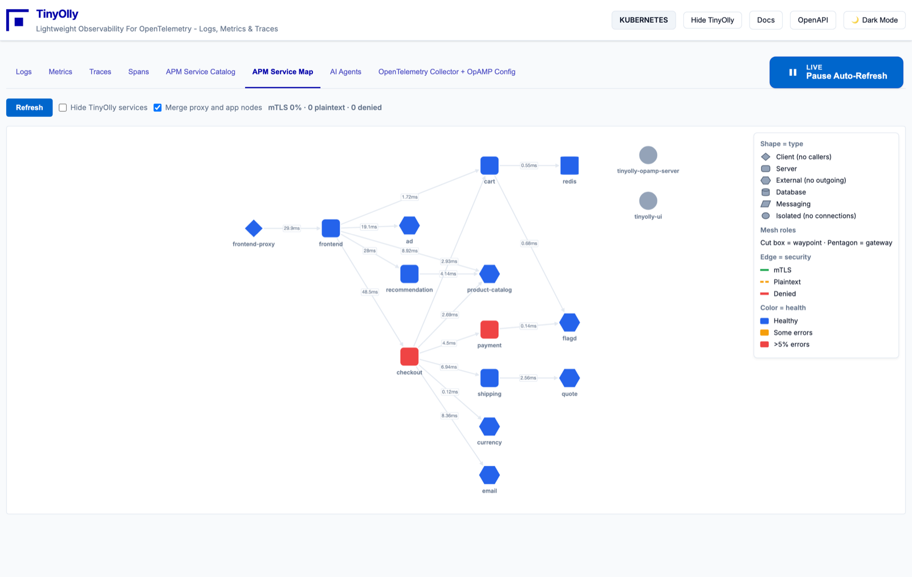
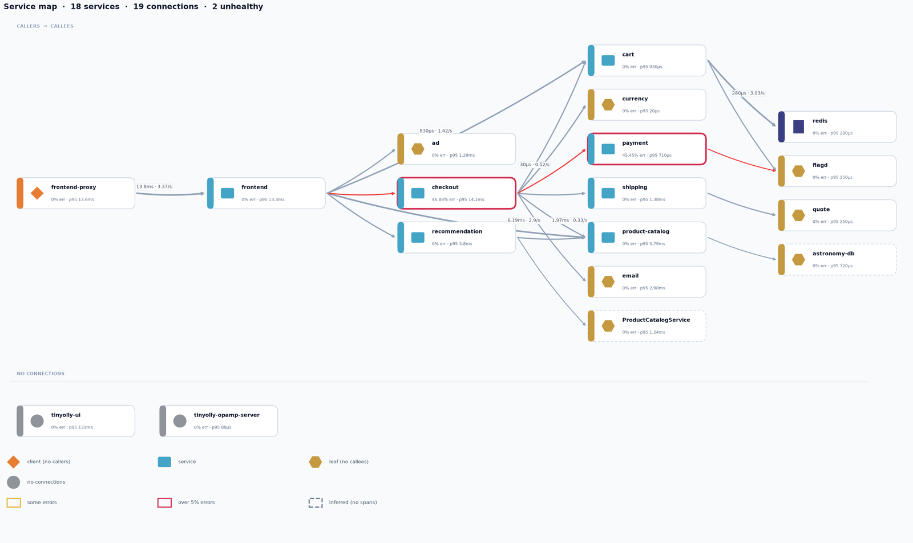
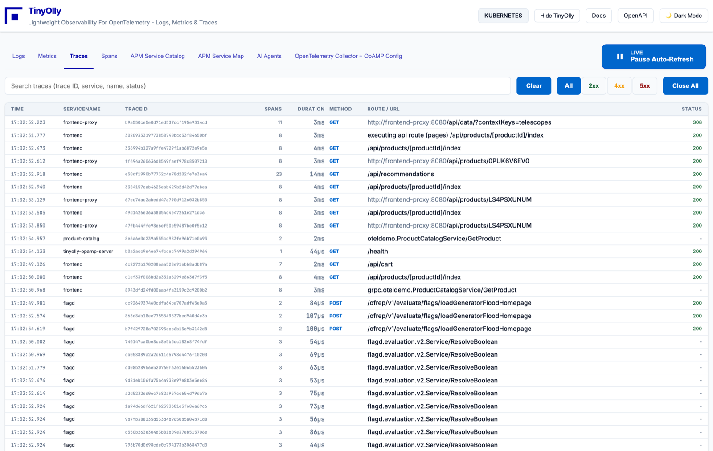
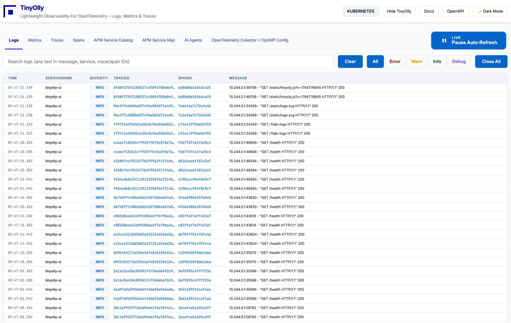

<div align="center">
  

  **The World's First Desktop Observability Platform**

  OpenTelemetry logs, metrics and traces on your laptop, and an AI assistant that can investigate them.

  
  
  
  

  <a href="docs/images/full/ui-otel-service-map.png"></a>

  [Docs](https://tinyolly.github.io/tinyolly/) · [Quick start](#quick-start) · [Demos](#demos) · [Ask an AI (MCP)](#ask-an-ai-about-your-telemetry-mcp) · [Teardown](#quick-teardown)
</div>

---

## Why TinyOlly

Why send telemetry to a cloud platform while you are coding? TinyOlly runs on your Mac, speaks OTLP natively, and gives you the views you would expect from a big platform without the setup.

- **Everything correlated:** service catalog with RED metrics, a service map, trace waterfalls with their logs, a metrics explorer with cardinality analysis. Share a deep link straight to a trace or span.
- **Local and bounded:** no cloud, no accounts. Pre-built images, SQLite storage with a 30-minute TTL and a 256 MB cap, so it never grows out of control.
- **A realistic demo built in:** the official OpenTelemetry Demo with failure injection, and an AI SRE agent that investigates the faults as they happen.
- **AI-ready:** a read-only MCP server with 28 tools and investigation playbooks. Ask Claude Code, Claude Desktop or Zed what is failing and why, and get charts back.
- **Collector control:** apply ready-made collector configs (tail sampling, PII redaction, enrichment) from the UI over OpAMP.
- **No Docker Desktop:** runs on [Colima](https://github.com/abiosoft/colima), with Docker or [kind](https://kind.sigs.k8s.io/) for Kubernetes, on Apple Silicon.

> **Local development only.** TinyOlly is not a replacement for a production observability platform.

## Quick start

TinyOlly runs on Kubernetes (kind) inside a Colima VM, on an Apple Silicon Mac with 24 GB or more.

```bash
brew install colima docker kubectl kind helm
git clone https://github.com/tinyolly/tinyolly && cd tinyolly
./scripts/colima-up.sh && ./scripts/kind-up.sh
./k8s/02-deploy-tinyolly.sh             # UI on http://localhost:5005
```

Four short steps, each adding to the last:

1. [Quick Start](docs/quickstart.md): TinyOlly running
2. [Add the Demo](docs/otel-demo.md): the OpenTelemetry Demo (Astronomy Shop)
3. [Add AI SRE](docs/ai-sre.md): an agent that investigates incidents (designed for a model on your LAN; Claude or OpenAI also work)
4. [Create Scenarios](docs/scenarios.md): flip a feature flag and watch the agent find the problem

[Send your own telemetry](docs/send-telemetry.md) to `localhost:4317` (gRPC) or `localhost:4318` (HTTP).

<table>
<tr>
<td width="50%" align="center"><a href="docs/images/full/ui-otel-failure-catalog.png"></a><br><sub>OpenTelemetry Demo: <code>checkout</code> and <code>payment</code> failing</sub></td>
<td width="50%" align="center"><a href="docs/images/full/ui-otel-failure-service-map.png"></a><br><sub>The same failure on the service map</sub></td>
</tr>
</table>

## Ask an AI about your telemetry (MCP)

TinyOlly ships a read-only [MCP](https://modelcontextprotocol.io) server with **28 tools** and investigation playbooks. It runs next to the UI, so there is nothing to start by hand. Connect an assistant once:

```bash
claude mcp add --transport http tinyolly http://127.0.0.1:8765/mcp     # Claude Code
```

Claude Desktop and Zed work too ([connect a client](docs/mcp-deploy.md)). Then ask in plain English; the assistant answers from your data and draws charts:

> *"Something is wrong with checkout. What is failing and why?"*
> *"Show me a failing order as a waterfall."*
> *"Draw the journey of that request over the map."*
> *"Which flag changed before payment started failing?"*
> *"Which service is the riskiest right now, and why?"*

<table>
<tr>
<td width="50%" align="center"><a href="docs/images/full/mesh-otel-failure-map.png"></a><br><sub><code>chart_service_map</code>: the failing services in red</sub></td>
<td width="50%" align="center"><a href="docs/images/full/mesh-otel-trace-path.png"></a><br><sub><code>chart_trace_path</code>: one failing order, hop by hop</sub></td>
</tr>
</table>

What the tools cover: services, traces (large ones are summarized and paged), logs, metrics, charts, TinyOlly's own docs, and a service-mesh toolkit for Istio (mTLS posture, denied calls, version split, authorization-policy drafts, Envoy response flags). Guides: [run and connect the server](docs/mcp-deploy.md) · [every tool and playbook](docs/mcp.md) · [investigate the OpenTelemetry Demo with an AI](docs/otel-demo-ai.md).

## The UI

<table>
<tr>
<td width="50%" align="center"><a href="docs/images/full/ui-traces.png"></a><br><sub>Traces: waterfall with correlated logs</sub></td>
<td width="50%" align="center"><a href="docs/images/full/ui-service-map.png"></a><br><sub>Service map with mTLS, plaintext and denied edges</sub></td>
</tr>
<tr>
<td width="50%" align="center"><a href="docs/images/full/ui-service-catalog.png"></a><br><sub>Service catalog with RED metrics</sub></td>
<td width="50%" align="center"><a href="docs/images/full/ui-metrics.png"></a><br><sub>Metrics explorer with cardinality analysis</sub></td>
</tr>
<tr>
<td width="50%" align="center"><a href="docs/images/full/ui-logs.png"></a><br><sub>Logs linked to traces and spans</sub></td>
<td width="50%" align="center"><a href="docs/images/full/ui-collector.png"></a><br><sub>Collector presets applied over OpAMP</sub></td>
</tr>
</table>
<p align="center"><sub>Click any screenshot to enlarge. They are generated: <code>scripts/make-doc-images.py</code>.</sub></p>

Also in the box: a [REST API with OpenAPI docs](docs/api.md) (`http://localhost:5005/docs`), [collector presets](docs/collector-presets.md) for tail sampling, PII redaction and OTTL transforms, [cardinality protection](docs/CARDINALITY-PROTECTION.md) for metrics, and Istio ambient support ([docs](docs/istio.md)).

## Quick teardown

```bash
scripts/status.sh                          # what is running, what is deployed, how to remove each
scripts/teardown.sh --level demos          # remove the demos
scripts/teardown.sh --level vms --prune    # + TinyOlly and the kind cluster, stop the VMs, clear build cache
```

`teardown.sh` is a dry run until you confirm, and only touches what this project creates. More in [Development and testing](docs/development.md#tear-everything-down).

## Learn more

| | |
|---|---|
| [Kubernetes](docs/kubernetes.md) | Size profiles, ports, local builds, troubleshooting, UI tour |
| [OpenTelemetry Collector and OpAMP](docs/otel-collector.md) | Collector config, presets |
| [Architecture and internals](docs/technical.md) · [Development and testing](docs/development.md) | How it works, tests, building images |
| [Release notes](release-notes/) | What is new in each version |

## License

**BSD 3-Clause**: free for individual developers, academic use and small organizations. **Commercial use** (50+ employees, production deployments, commercial products) requires a license; see [`LICENSE`](./LICENSE) and the [licensing page](docs/licensing.md).

---

<div align="center">
  <p>Built for the OpenTelemetry community</p>
  <p>
    <a href="https://github.com/tinyolly/tinyolly">GitHub</a> •
    <a href="https://github.com/tinyolly/tinyolly/issues">Issues</a>
  </p>
</div>
