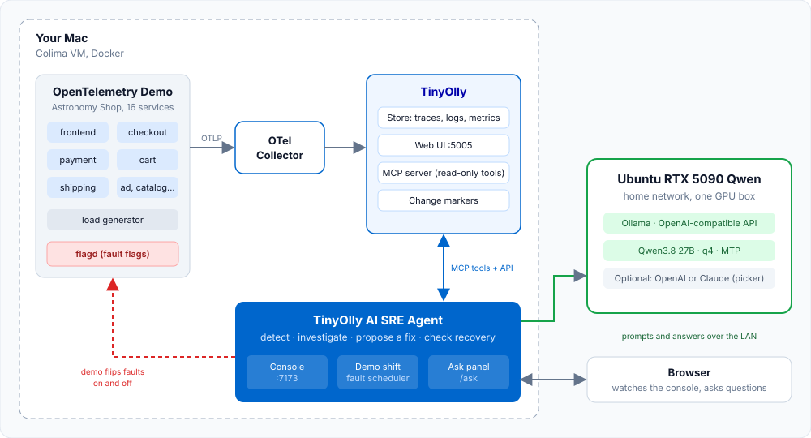
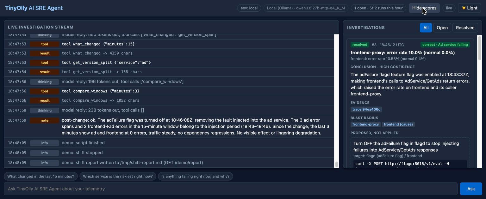

# TinyOlly AI SRE Agent

The TinyOlly AI SRE Agent watches the telemetry in TinyOlly. When a service starts failing, slowing down or going quiet, it opens an incident, investigates it once with a model and TinyOlly's read-only [MCP tools](mcp.md), and writes a conclusion: the root cause, the evidence (a trace you can click), the blast radius, and up to three fixes. The fixes are **proposed, never applied**. When the signals clear, it checks whether the service really recovered.

!!! note "Built with a local model"
    The agent was built and tested against a **local Ollama model**: Qwen3.8 27B (q4, MTP) on one RTX 5090 GPU box on the home network ("Ubuntu RTX 5090 Qwen"). That is the default. Any Ollama box works; OpenAI and Claude are optional presets in the console's model picker. Results on this page come from the local model.

[](images/ai-sre-local-setup.svg)

## Start it

You need TinyOlly core and, for faults to investigate, the [OpenTelemetry Demo](otel-demo.md).

**Docker**

```bash
cd docker
SRE_LLM_URL=http://<your-ollama-host>:11434/v1 ./05-start-sre.sh      # agent only
SRE_LLM_URL=http://<your-ollama-host>:11434/v1 ./05-start-sre.sh --demo   # agent + demo shift (quick profile)
./05-stop-sre.sh                                                             # stop the agent (flags are reset on exit)
```

Open the console at [http://localhost:7173](http://localhost:7173). With `--demo` the first fault starts after about a minute, once the agent has learned what normal looks like (about 4 minutes with `--realistic` or without `--demo`).

**Kubernetes (kind)**

```bash
k8s/06-rebuild+deploy-sre.sh          # agent only
k8s/06-rebuild+deploy-sre.sh --demo   # agent + demo shift (quick profile); needs k8s-otel-demo deployed
kubectl port-forward deploy/tinyolly-sre 7173:8080
```

On k8s the demo shift changes flags through the OTel demo's `flagd-ui` API (`http://flagd:4000`), which edits the file flagd serves; the change is live at once and the agent needs no extra RBAC. (Editing the `flagd-config` ConfigMap does not work with this Helm chart: flagd copies it once at pod start.)

## Choose a model

| Preset | Default model | Enable it |
|---|---|---|
| Local (Ollama), **default** | `qwen3.8:27b-mtp-q4_K_M` | `SRE_LLM_URL` (any OpenAI-compatible endpoint) and `SRE_MODEL` |
| OpenAI | `gpt-5` (`SRE_OPENAI_MODEL`) | `OPENAI_API_KEY` set in the shell that starts the agent |
| Claude | `claude-opus-5-5` (`SRE_ANTHROPIC_MODEL`) | `ANTHROPIC_API_KEY` set in the shell that starts the agent |

A preset appears in the console's model picker only when it is configured; switch at any time, and the next investigation uses the new model. `SRE_PRESET=claude` (or `openai`) starts on a cloud preset. On k8s, put the keys in a secret: `kubectl create secret generic tinyolly-sre-llm --from-literal=ANTHROPIC_API_KEY=...`.

The Claude preset calls the Anthropic API through the official SDK with server-side refusal fallbacks enabled (a declined request is re-run on a fallback model) and `ANTHROPIC_EFFORT` (default `medium`). Cloud presets send telemetry excerpts (span names, service names, error messages) to the provider; the local default sends nothing off your network.

## The console

[](images/ai-sre-console-light.png)

- **Live investigation stream** (left): every step the agent takes, as it happens: detector signals, the evidence it fetched, the prompt, each tool call and result, the finding. Click a line to see the full text.
- **Investigations** (right): one card per incident:
    - **Triage:** `act now`, `watch` or `noise`, and whether it **would page** an on-call engineer (shadow mode: nothing is paged; the shift report scores these decisions).
    - **Conclusion** with confidence, and the **theories** the agent considered: confirmed ✓, ruled out ✗ (with the fact that decided it), or open.
    - **Evidence trail:** the cited trace and every query the agent ran; each chip opens the same view in TinyOlly (logs for a service, spans, the trace, the map), and hovering shows what came back.
    - **Timeline:** the related change marker, detection, each new symptom, investigation, conclusion, proposed fix, recovery.
    - Blast radius, proposed fixes (never applied), and the recovery result with time to resolve.
    - **Write postmortem:** a blameless draft (summary, impact, timeline, root cause, theories, 5 whys, evidence, action items) built from the record, with the narrative written by the model. Copy it or download it as markdown.
- **Ask** (bottom): free-form questions about your telemetry.
- **Header**: environment, model picker, open incidents and the hourly budget, the demo state, and the theme switch.

[](images/ai-sre-console-dark.png)

## Demo shift

The demo shift runs faults on a timer so problems come and go while the agent is on shift, like a real on-call. It flips [OpenTelemetry Demo feature flags](otel-demo.md#failure-injection-with-feature-flags), holds each fault for a few minutes, turns it off, and moves on. Every flag goes back to `off` when the shift starts, stops, or the agent exits.

The agent is never told what was injected. It learns about a flag flip the way it would in production: a **change marker** (`flag paymentFailure: off -> 50%`) in TinyOlly, which it reads with its `what_changed` tool. Set `DEMO_ANNOUNCE=0` to withhold the markers for a harder run.

| Scenario | Flag | What the agent should find |
|---|---|---|
| `payment-degraded` | `paymentFailure=50%` | checkout errors; the cause is payment |
| `payment-down` | `paymentUnreachable=on` | hard dependency outage |
| `cart-flaky` | `cartFailure=25%` | partial errors seen by several callers |
| `ad-failure` | `adFailure=on` | errors in one service |
| `slow-images` | `imageSlowLoad=5sec` | frontend latency, cause upstream |
| `slow-shipping` | `intlShippingSlowdown=5sec` | latency on one path only |
| `catalog-lock` | `productCatalogLockContention=on` | latency from the database |
| `catalog-bad-product` | `productCatalogFailure=on` | errors on one product only |
| `recommendation-cache` | `recommendationCacheFailure=on` | slow path, subtle |
| `traffic-flood` | `loadGeneratorFloodHomepage=on` | load, not a bug: capacity |
| `quiet` | none | **control**: the agent should open nothing |

Scenarios are data: `docker/apps/tinyolly-sre/sre/scenarios.json`.

**Run order.** By default the shift picks at random (never the same fault twice in a row) and inserts a quiet period every 4 faults; `DEMO_SEED` makes it repeatable. For a rehearsed demo, fix the order: `DEMO_SCRIPT=payment-degraded,slow-shipping,quiet ./05-start-sre.sh --demo`; the shift ends when the script does.

**Controls.** `POST /demo/start`, `/demo/pause`, `/demo/stop`, `/demo/reset` (all flags off), and `/demo/trigger` with `{"id": "slow-images"}` to run one fault now. `GET /demo/status` shows what is running; the console header shows only `demo: running · next fault in 2:40`, so the room does not see the answer before the agent does.

**Scores.** The presenter's **Reveal scores** button marks each card against the fault that was really injected: `correct` (named the faulty service and the cause), `partial`, `wrong`, `false positive` (nothing was injected), or `no answer`. Faults that never opened an incident count as missed. At the end of a shift the agent writes a markdown report (`GET /demo/report`) with counts, paging decisions (faults that would have paged, missed pages, false pages), time to detect and resolve, tool calls and tokens per incident. Samples are small; the report gives counts, not percentages.

**Profiles.** The demo shift runs the **quick** profile by default, so problems appear and clear in seconds and a scenario takes about 2 minutes (all 11 in about 25):

| | Quick (default) | Realistic (`--realistic`) |
|---|---|---|
| Faults | stronger variants (`paymentFailure=90%`, `cartFailure=75%`, `10sec` slowdowns), 75-90 s each | the variants in the table above, 4-6 min each |
| Between faults | 30 s cooldown and a clean cutoff (earlier telemetry is ignored), 20-30 s gap | 2.5-3 min cooldown for errors to age out, 1-2 min gap |
| Shop load | raised to 20 simulated users (`DEMO_LOAD_USERS`) | the demo's default (3 users) |
| Detection | every 5 s; error rate, rate and p95 from the last 30 s of spans | every 30 s; rate and p95 from the service catalog |
| Change notes | off (the model stays free for investigations; it still sees each flag flip with `what_changed`) | a change-risk note and a post-change check per flip |

Use realistic to show the agent under conditions closer to production: smaller faults, less traffic, slower signals.

**Tuning without waiting.** Record a shift once (`SRE_RECORD=/tmp/shift.jsonl`), then replay it through the detectors in seconds, or through the model in a few minutes, after every change: see "Fast iteration" in the [agent's README](https://github.com/tinyolly/tinyolly/tree/main/docker/apps/tinyolly-sre).

## How it decides

Detectors run without a model every 30 s: error spans, error rate, p95 latency, traffic drop, a service that stops reporting, error logs, mesh denials and plaintext edges, and TinyOlly's own storage pressure. Each service gets a learned normal; a change must hold for two polls before it counts. Services called only a few times a minute are measured over a longer window so a partial fault still shows. Signals on a service and its direct callers or callees join one incident, investigated from the deepest service. Thresholds and every setting are in the [agent's README](https://github.com/tinyolly/tinyolly/tree/main/docker/apps/tinyolly-sre).

**Guardrails:** at most 8 tool calls and 120 s per investigation, 12 investigations an hour, read-only tools only, and cited traces and services are kept only if they appeared in the evidence.

## Limits

- Synthetic faults on a demo shop are not production; a good score here says little about real incidents.
- In the realistic profile the latency and traffic detectors compare against long averages, so a slow-service fault can take minutes to show and to clear.
- Two unrelated faults close together can merge into one incident through a shared caller such as `frontend`.
- One model run at a time: a change note or review can delay an investigation by up to a minute.
