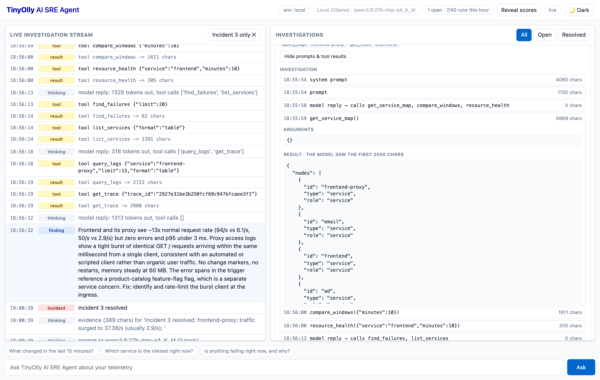

# TinyOlly AI SRE Agent

The agent watches TinyOlly's telemetry. When a service fails, slows down or goes quiet, it opens an incident, investigates it with a model and TinyOlly's read-only [MCP tools](mcp.md), and reports the root cause, evidence, blast radius and up to three fixes. Fixes are **proposed, never applied**. When the signals clear, it checks the recovery.

!!! note "Built with a local model"
    Built and tested with a **local Ollama model**: Qwen3.8 27B (q4, MTP) on one RTX 5090 box on the home network ("Ubuntu RTX 5090 Qwen"). That is the default; any Ollama host works, and OpenAI and Claude are optional.

[](images/ai-sre-local-setup.svg)

## Start it

Needs TinyOlly core and the [OpenTelemetry Demo](otel-demo.md).

```bash
cd docker
SRE_LLM_URL=http://<your-ollama-host>:11434/v1 ./05-start-sre.sh      # agent only
SRE_LLM_URL=http://<your-ollama-host>:11434/v1 ./05-start-sre.sh --demo   # agent + demo shift (quick profile)
./05-stop-sre.sh                                                             # stop the agent (flags are reset on exit)
```

Console: [http://localhost:7173](http://localhost:7173). With `--demo` the first fault starts after about a minute (about 4 minutes with `--realistic`), once the agent has learned what normal looks like.

On kind:

```bash
k8s/06-rebuild+deploy-sre.sh          # agent only
k8s/06-rebuild+deploy-sre.sh --demo   # agent + demo shift (quick profile); needs k8s-otel-demo deployed
kubectl port-forward deploy/tinyolly-sre 7173:8080
```

On k8s the shift flips flags through the demo's `flagd-ui` API (`http://flagd:4000`), live at once and without extra RBAC. Editing the `flagd-config` ConfigMap does not work: the Helm chart copies it into flagd only at pod start.

## Choose a model

| Preset | Default model | Enable it |
|---|---|---|
| Local (Ollama), **default** | `qwen3.8:27b-mtp-q4_K_M` | `SRE_LLM_URL` (any OpenAI-compatible endpoint) and `SRE_MODEL` |
| OpenAI | `gpt-5` (`SRE_OPENAI_MODEL`) | `OPENAI_API_KEY` set in the shell that starts the agent |
| Claude | `claude-opus-5-5` (`SRE_ANTHROPIC_MODEL`) | `ANTHROPIC_API_KEY` set in the shell that starts the agent |

Configured presets appear in the console's model picker; switching applies to the next investigation. `SRE_PRESET=claude` (or `openai`) starts on a cloud preset; on k8s put the keys in a secret: `kubectl create secret generic tinyolly-sre-llm --from-literal=ANTHROPIC_API_KEY=...`. Claude uses the official SDK with refusal fallbacks (`ANTHROPIC_EFFORT`, default `medium`). Cloud presets send telemetry excerpts (span and service names, error messages) to the provider; the local default keeps everything on your network.

## The console

[](images/ai-sre-console-light.png)

- **Live stream** (left): every step as it happens: signals, evidence, prompt, tool calls and results, finding. Click a line for the full text.
- **Investigation cards** (right), one per incident:
    - **Triage:** `act now`, `watch` or `noise`, and whether it **would page** (shadow mode: nothing is paged; the shift report scores it).
    - **Conclusion** with confidence, and the **theories** considered: confirmed ✓, ruled out ✗ with the deciding fact, or open.
    - **Evidence trail:** the cited trace and every query the agent ran; each chip opens that view in TinyOlly, and hovering shows the result.
    - **Timeline:** related change marker, detection, new symptoms, investigation, conclusion, fix, recovery.
    - Blast radius, proposed fixes, recovery result and time to resolve.
    - **Write postmortem:** a blameless draft (summary, impact, timeline, root cause, theories, 5 whys, evidence, action items) to copy or download as markdown.
- **Ask** (bottom): free-form questions about your telemetry.

[](images/ai-sre-console-dark.png)

## Demo shift

The demo shift flips [OpenTelemetry Demo feature flags](otel-demo.md#failure-injection-with-feature-flags) on a timer, so problems come and go. All flags reset to `off` on start, stop and exit.

The agent is never told what was injected. It finds problems from telemetry alone. `DEMO_ANNOUNCE=1` also publishes each flip as a **change marker** (`flag paymentFailure: off -> 50%`) it can read with `what_changed`, as a real flag system would.

| Scenario | Flag | What the agent should find |
|---|---|---|
| `payment-degraded` | `paymentFailure=50%` | checkout errors; the cause is payment |
| `payment-down` | `paymentUnreachable=on` | hard dependency outage |
| `cart-flaky` | `cartFailure=25%` | partial errors seen by several callers |
| `ad-failure` | `adFailure=on` | errors in one service |
| `slow-images` | `imageSlowLoad=5sec` | frontend latency, cause upstream |
| `slow-shipping` | `intlShippingSlowdown=5sec` | latency on one path only |
| `catalog-lock` | `productCatalogLockContention=on` | latency from the database |
| `catalog-bad-product` | `productCatalogFailure=on` | errors on one product only |
| `recommendation-cache` | `recommendationCacheFailure=on` | slow path, subtle |
| `traffic-flood` | `loadGeneratorFloodHomepage=on` | load, not a bug: capacity |
| `quiet` | none | **control**: the agent should open nothing |

Scenarios are data: `docker/apps/tinyolly-sre/sre/scenarios.json`.

- **Order:** random (never the same fault twice in a row, a quiet period every 4 faults; `DEMO_SEED` makes it repeatable), or fixed for a rehearsed demo: `DEMO_SCRIPT=payment-degraded,slow-shipping,quiet ./05-start-sre.sh --demo` (the shift ends with the script).
- **Controls:** `POST /demo/start`, `/demo/pause`, `/demo/stop`, `/demo/reset` (all flags off), `/demo/trigger` with `{"id": "slow-images"}`. `GET /demo/status` shows what runs; the header shows only `demo: running · next fault in 2:40`, so the room does not see the answer first.
- **Scores:** **Reveal scores** marks each card against the injected fault: `correct` (service and cause), `partial`, `wrong`, `false positive`, `no answer`; faults with no incident count as missed. `GET /demo/report` is the shift report: counts, paging decisions, time to detect and resolve, tool calls and tokens. Samples are small, so it gives counts, not percentages.

**Profiles.** **Quick** is the default: a scenario takes about 2 minutes (all 11 in about 25).

| | Quick (default) | Realistic (`--realistic`) |
|---|---|---|
| Faults | stronger variants (`paymentFailure=90%`, `cartFailure=75%`, `10sec` slowdowns), 75-90 s each | the variants in the table above, 4-6 min each |
| Between faults | 30 s cooldown and a clean cutoff (earlier telemetry is ignored), 20-30 s gap | 2.5-3 min cooldown for errors to age out, 1-2 min gap |
| Shop load | 20 simulated users (`DEMO_LOAD_USERS`) | the demo's default (3 users) |
| Detection | every 5 s; error rate, rate and p95 from the last 30 s of spans | every 30 s; rate and p95 from the service catalog |
| Change notes | off (the model stays free for investigations) | a change-risk note and a post-change check per flip |

To tune without waiting, record a shift once (`SRE_RECORD=/tmp/shift.jsonl`) and replay it through the detectors in seconds or the model in minutes: see "Fast iteration" in the [agent's README](https://github.com/tinyolly/tinyolly/tree/main/docker/apps/tinyolly-sre).

## How it decides

Detectors run without a model: error spans, error rate (per service and per operation), p95 latency, traffic drop, a service that stops reporting, error logs, mesh denials, and TinyOlly's storage pressure. Each service learns its normal; a change must hold for two polls. Signals on a service and its direct callers or callees join one incident, investigated from the deepest service. Settings are in the [agent's README](https://github.com/tinyolly/tinyolly/tree/main/docker/apps/tinyolly-sre).

**Guardrails:** at most 8 tool calls and 120 s per investigation, 12 investigations an hour, read-only tools, and cited traces and services are kept only if they appeared in the evidence.

## Limits

- Synthetic faults are not production; a good score says little about real incidents.
- With `--realistic`, several faults leave too little signal at the demo's low traffic to detect.
- Two unrelated faults close together can merge into one incident through a shared caller such as `frontend`.
- One model run at a time: a review can delay an investigation by up to a minute.
