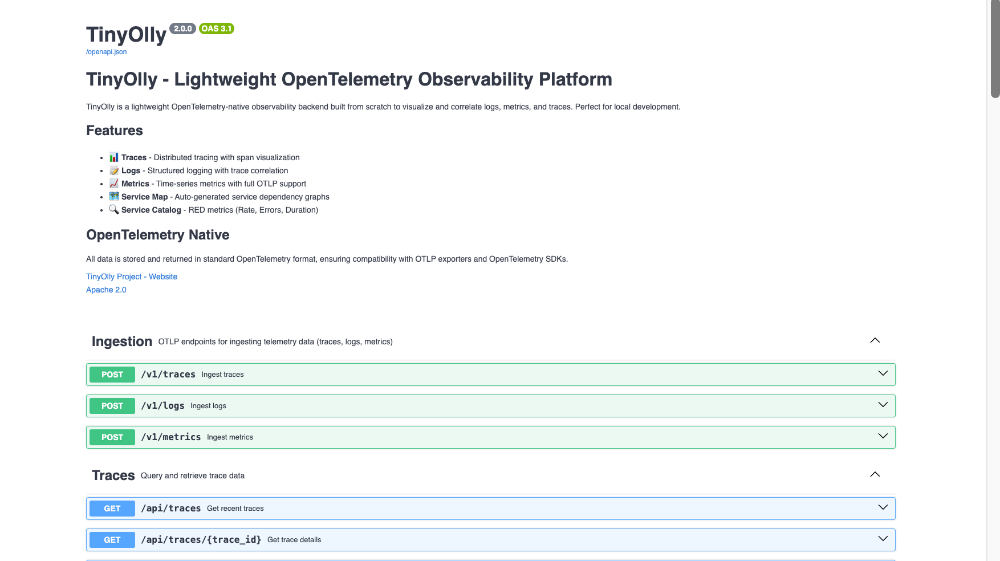

# REST API & OpenAPI

<div align="center">
  
  <p><em>OpenAPI documentation with interactive Swagger UI</em></p>
</div>

---

TinyOlly provides a comprehensive REST API for programmatic access to all telemetry data in **OpenTelemetry-native format**.

## Interactive API Documentation

Access the auto-generated OpenAPI documentation:
- **Swagger UI**: `http://localhost:5005/docs` - Interactive API explorer
- **ReDoc**: `http://localhost:5005/redoc` - Alternative documentation
- **OpenAPI Spec**: `http://localhost:5005/openapi.json` - Machine-readable schema

All APIs return **OpenTelemetry-native JSON** with:
- **Resources**: `service.name`, `host.name`, etc.
- **Attributes**: Metric labels and span attributes
- **Full Context**: Trace/span IDs, timestamps, status codes

---

## API Endpoints Overview

The REST API provides endpoints for:

| Endpoint | Method | Description |
|----------|--------|-------------|
| `/api/traces` | GET | List recent traces with filtering |
| `/api/traces/{trace_id}` | GET | Get detailed trace with all spans |
| `/api/spans` | GET | List recent spans with filtering |
| `/api/logs` | GET | Retrieve logs with trace correlation |
| `/api/metrics` | GET | List metrics with type, unit, description and cardinality |
| `/api/metrics/query` | GET | Time series for one metric, with `resource.*` / `attribute.*` filters and `start`/`end` |
| `/api/metrics/{name}` | GET | Time series for one metric (no filters) |
| `/api/service-map` | GET | Get service dependency graph |
| `/api/service-catalog` | GET | List services with RED metrics |
| `/api/stats` | GET | System stats and cardinality info |
| `/admin/stats` | GET | Detailed admin statistics |
| `/health` | GET | Health check endpoint |

All endpoints return data in standard OpenTelemetry format, ensuring compatibility with OpenTelemetry tooling and standards.

---

## Common API Workflows

### 1. Get All Recent Traces

Retrieve the last 50 traces:

=== "cURL"
    ```bash
    curl http://localhost:5005/api/traces?limit=50
    ```

=== "Python"
    ```python
    import requests

    response = requests.get('http://localhost:5005/api/traces', params={'limit': 50})
    traces = response.json()

    for trace in traces:
        print(f"Trace {trace['trace_id']}: {trace['service_name']} - {trace['name']}")
    ```

=== "JavaScript"
    ```javascript
    fetch('http://localhost:5005/api/traces?limit=50')
      .then(response => response.json())
      .then(traces => {
        traces.forEach(trace => {
          console.log(`Trace ${trace.trace_id}: ${trace.service_name} - ${trace.name}`);
        });
      });
    ```

**Response Format:**
```json
[
  {
    "trace_id": "a1b2c3d4e5f6g7h8i9j0k1l2m3n4o5p6",
    "service_name": "demo-frontend",
    "name": "GET /products",
    "start_time": 1701234567890000000,
    "duration_ms": 125.4,
    "status_code": 200,
    "method": "GET",
    "route": "/products",
    "span_count": 5
  }
]
```

---

### 2. Get Detailed Trace with Waterfall

Retrieve a complete trace with all spans for waterfall visualization:

=== "cURL"
    ```bash
    curl http://localhost:5005/api/traces/a1b2c3d4e5f6g7h8i9j0k1l2m3n4o5p6
    ```

=== "Python"
    ```python
    import requests

    trace_id = "a1b2c3d4e5f6g7h8i9j0k1l2m3n4o5p6"
    response = requests.get(f'http://localhost:5005/api/traces/{trace_id}')
    trace = response.json()

    print(f"Trace: {trace['name']}")
    print(f"Total spans: {len(trace['spans'])}")
    print(f"Duration: {trace['duration_ms']}ms")

    for span in trace['spans']:
        indent = "  " * span.get('level', 0)
        print(f"{indent}{span['name']} ({span['duration_ms']}ms)")
    ```

**Response Format:**
```json
{
  "trace_id": "a1b2c3d4e5f6g7h8i9j0k1l2m3n4o5p6",
  "name": "GET /products",
  "service_name": "demo-frontend",
  "start_time": 1701234567890000000,
  "duration_ms": 125.4,
  "span_count": 5,
  "spans": [
    {
      "span_id": "1234567890abcdef",
      "parent_span_id": null,
      "name": "GET /products",
      "service_name": "demo-frontend",
      "start_time": 1701234567890000000,
      "duration_ms": 125.4,
      "status": {"code": 1},
      "attributes": {
        "http.method": "GET",
        "http.route": "/products",
        "http.status_code": 200
      }
    }
  ]
}
```

---

### 3. Find Logs for a Specific Trace

Correlate logs with a trace using trace_id:

=== "cURL"
    ```bash
    curl "http://localhost:5005/api/logs?trace_id=a1b2c3d4e5f6g7h8i9j0k1l2m3n4o5p6"
    ```

=== "Python"
    ```python
    import requests

    trace_id = "a1b2c3d4e5f6g7h8i9j0k1l2m3n4o5p6"
    response = requests.get('http://localhost:5005/api/logs',
                           params={'trace_id': trace_id})
    logs = response.json()

    for log in logs:
        print(f"[{log['severity']}] {log['body']}")
    ```

**Response Format:**
```json
[
  {
    "timestamp": 1701234567890000000,
    "trace_id": "a1b2c3d4e5f6g7h8i9j0k1l2m3n4o5p6",
    "span_id": "1234567890abcdef",
    "severity": "INFO",
    "body": "Processing product request",
    "service_name": "demo-frontend",
    "attributes": {
      "user_id": "12345"
    }
  }
]
```

---

### 4. Query Metrics

List the available metrics (metadata only), then fetch one metric's time series:

=== "cURL"
    ```bash
    # What metrics exist?
    curl "http://localhost:5005/api/metrics?limit=100"

    # Time series for one metric, last 10 minutes by default (start/end are Unix seconds)
    curl "http://localhost:5005/api/metrics/query?name=http.server.duration"

    # Filter by resource and metric attributes
    curl "http://localhost:5005/api/metrics/query?name=http.server.duration&resource.service.name=demo-frontend&attribute.http.method=GET"
    ```

=== "Python"
    ```python
    import requests

    base = 'http://localhost:5005'
    for m in requests.get(f'{base}/api/metrics', params={'limit': 100}).json():
        print(f"{m['name']} ({m['type']}, {m['unit']}) services={m['services']}")

    d = requests.get(f'{base}/api/metrics/query',
                     params={'name': 'http.server.duration', 'resource.service.name': 'demo-frontend'}).json()
    for s in d['series']:
        print(s['attributes'], [(p['timestamp'], p['value']) for p in s['datapoints'][-3:]])
    ```

**`/api/metrics` response** (one entry per metric):
```json
[{"name": "http.server.duration", "type": "histogram", "unit": "ms", "description": "HTTP request duration",
  "resource_count": 3, "attribute_combinations": 12, "label_count": 4, "services": ["demo-frontend"]}]
```

**`/api/metrics/query` response:**
```json
{
  "name": "http.server.duration", "type": "histogram", "unit": "ms", "description": "HTTP request duration",
  "series": [
    {
      "resource": {"service.name": "demo-frontend"},
      "attributes": {"http.method": "GET", "http.route": "/products"},
      "datapoints": [{"timestamp": 1701234567.89, "value": 42.0, "histogram": null, "summary": null}],
      "exemplars": []
    }
  ]
}
```

---

### 5. Get Service Catalog with RED Metrics

List all services with Rate, Errors, and Duration metrics:

=== "cURL"
    ```bash
    curl http://localhost:5005/api/service-catalog
    ```

=== "Python"
    ```python
    import requests

    response = requests.get('http://localhost:5005/api/service-catalog')
    services = response.json()

    for service in services:
        print(f"\n{service['service_name']}")
        print(f"  Request Rate: {service.get('request_rate', 0):.2f} req/s")
        print(f"  Error Rate: {service.get('error_rate', 0):.2f}%")
        print(f"  P50 Latency: {service.get('p50_latency', 0):.2f}ms")
        print(f"  P95 Latency: {service.get('p95_latency', 0):.2f}ms")
    ```

**Response Format:**
```json
[
  {
    "service_name": "demo-frontend",
    "span_count": 1523,
    "request_rate": 12.5,
    "error_rate": 2.3,
    "p50_latency": 45.2,
    "p95_latency": 125.7,
    "p99_latency": 250.3,
    "first_seen": 1701234567890000000,
    "last_seen": 1701238167890000000
  }
]
```

---

### 6. Get Service Dependency Map

Retrieve the service dependency graph:

=== "cURL"
    ```bash
    curl http://localhost:5005/api/service-map
    ```

=== "Python"
    ```python
    import requests

    response = requests.get('http://localhost:5005/api/service-map')
    graph = response.json()

    print("Services:", len(graph['nodes']))
    for node in graph['nodes']:
        print(f"  - {node['service_name']} ({node['type']})")

    print("\nConnections:", len(graph['edges']))
    for edge in graph['edges']:
        print(f"  {edge['source']} → {edge['target']} ({edge['call_count']} calls)")
    ```

**Response Format:**
```json
{
  "nodes": [
    {
      "service_name": "demo-frontend",
      "type": "server",
      "span_count": 1523
    },
    {
      "service_name": "demo-backend",
      "type": "server",
      "span_count": 3046
    }
  ],
  "edges": [
    {
      "source": "demo-frontend",
      "target": "demo-backend",
      "call_count": 1523
    }
  ]
}
```

---

### 7. Check System Statistics

Get SQLite database usage and cardinality metrics:

=== "cURL"
    ```bash
    curl http://localhost:5005/api/stats
    ```

=== "Python"
    ```python
    import requests

    response = requests.get('http://localhost:5005/api/stats')
    stats = response.json()

    print(f"Total Traces: {stats.get('total_traces', 0)}")
    print(f"Total Spans: {stats.get('total_spans', 0)}")
    print(f"Total Logs: {stats.get('total_logs', 0)}")
    print(f"Total Metrics: {stats.get('total_metrics', 0)}")
    print(f"Unique Metric Names: {stats.get('unique_metric_names', 0)}")
    print(f"DB Size: {stats.get('db_size_mb', 0):.2f} MB")
    ```

**Response Format:**
```json
{
  "total_traces": 1523,
  "total_spans": 7615,
  "total_logs": 15230,
  "total_metrics": 45,
  "unique_metric_names": 12,
  "db_size_mb": 45.7,
  "db_size_limit_mb": 256,
  "cardinality_limit": 1000,
  "cardinality_usage_pct": 1.2,
  "uptime_seconds": 3600
}
```

---

## Advanced Filtering

### Filter Spans by Service

```bash
curl "http://localhost:5005/api/spans?service=demo-frontend&limit=100"
```

### Filter Logs by Severity

```bash
curl "http://localhost:5005/api/logs?severity=ERROR&limit=50"
```

### Time-based Queries

All endpoints support `start_time` and `end_time` parameters (Unix nanoseconds):

```bash
# Get traces from the last hour
START=$(date -u -d '1 hour ago' +%s)000000000
END=$(date -u +%s)000000000
curl "http://localhost:5005/api/traces?start_time=$START&end_time=$END"
```

---

## Client Generation

Generate API clients in any language using the OpenAPI spec:

```bash
# Download OpenAPI spec
curl http://localhost:5005/openapi.json > tinyolly-openapi.json

# Generate Python client
openapi-generator-cli generate \
  -i tinyolly-openapi.json \
  -g python \
  -o ./tinyolly-python-client

# Generate Go client
openapi-generator-cli generate \
  -i tinyolly-openapi.json \
  -g go \
  -o ./tinyolly-go-client

# Generate TypeScript client
openapi-generator-cli generate \
  -i tinyolly-openapi.json \
  -g typescript-fetch \
  -o ./tinyolly-ts-client
```

---

## Limits

TinyOlly is designed for local development:

- **Retention**: records expire after 30 minutes by default (`SQLITE_TTL_SECONDS`), and the SQLite database is capped at 256 MB (`MAX_DB_SIZE_MB`); the oldest records are evicted first when it fills.
- **Cardinality protection** limits unique metric names to 1000 (`MAX_METRIC_CARDINALITY`).
- **Request size**: OTLP ingest bodies and gRPC messages are size-capped so a runaway exporter cannot fill the database; very large single batches may need the caps raised (see the receiver's `GRPC_MAX_MESSAGE_BYTES`).
- **List endpoints** accept `limit` (max 5000).

---

## Authentication

TinyOlly is a local-only tool and has no authentication, CORS restrictions or origin checks. Do not expose it beyond your machine.

---

## Need Help?

- [View interactive examples in Swagger UI](http://localhost:5005/docs)
- [Open an issue on GitHub](https://github.com/tinyolly/tinyolly/issues)
- [Read the technical architecture](technical.md)
- [Query telemetry from an AI agent (MCP)](mcp.md)
