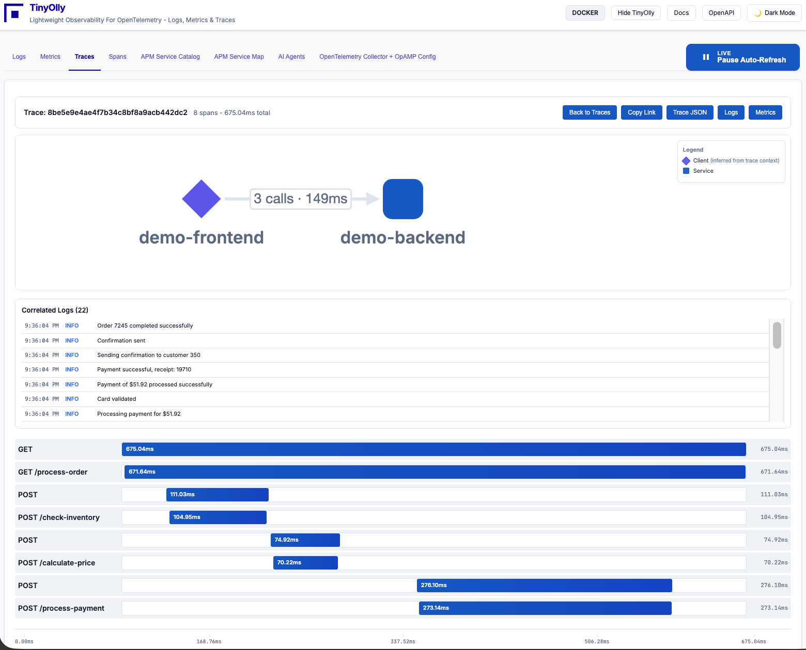

# Docker Deployment

Get TinyOlly running on Docker in minutes!

<div align="center">
  
  <p><em>TinyOlly UI showing distributed traces</em></p>
</div>

---

All examples are launched from the repo - clone it first or download the current GitHub release archive:
```bash
git clone https://github.com/tinyolly/tinyolly
```

## 1. Deploy TinyOlly Core (Required)

Start the observability backend (OTel Collector, TinyOlly Receiver, SQLite, UI):

```bash
cd docker
./01-start-core.sh
```

This starts:
- **OTel Collector**: Listening on `localhost:4317` (gRPC) and `localhost:4318` (HTTP)  
- **OpAMP Server**: `ws://localhost:4320/v1/opamp` (WebSocket), `localhost:4321` (HTTP REST API)  
- **TinyOlly UI**: `http://localhost:5005`  
- **TinyOlly OTLP Receiver and its SQLite storage**: OTLP observability back end and storage  
- Pulls images from Docker Hub (use `./01-start-core-local.sh` to build from your checkout instead)  

**Open the UI:** `http://localhost:5005` (empty until you send data)

!!! note
    `01-start-core.sh` starts from a clean slate: it removes the SQLite data volume and the supervisor's cached collector config on every run. Use `docker compose -f docker-compose-tinyolly-core.yml restart` to keep data.

**OpenTelemetry Collector + OpAMP Config Page:** Navigate to the "OpenTelemetry Collector + OpAMP Config" tab in the UI to view and manage collector configurations remotely. See the [OpAMP Configuration](#opamp-configuration-optional) section below for setup instructions.

**Stop core services:**
```bash
./02-stop-core.sh
```

---

## 2. Deploy Demo Apps (Optional)

Deploy two Flask microservices with automatic traffic generation:

```bash
cd docker-demo
./01-deploy-demo.sh
```

Wait 30 seconds. **The demo apps automatically generate traffic** - traces, logs, and metrics will appear in the UI!

**Stop demo apps:**
```bash
./02-cleanup-demo.sh
```

This leaves TinyOlly core running. To stop everything:
```bash
cd docker
./02-stop-core.sh
```

---

## 3. AI Agent Demo with Ollama (Optional)

Deploy an AI agent demo with zero-code OpenTelemetry auto-instrumentation for GenAI:

```bash
cd docker-ai-agent-demo
./01-deploy-ai-demo.sh
```

!!! note
    First run will pull the Ollama image and TinyLlama model (~1.5GB total). This may take a few minutes.

This starts:
- **Ollama**: Local LLM server with TinyLlama model (`http://localhost:11434`)
- **AI Agent**: Python agent making LLM calls every 15 seconds, auto-instrumented with `opentelemetry-instrumentation-ollama`

**View AI Traces:** Navigate to the **AI Agents** tab in TinyOlly UI to see:

- Prompts and responses for each LLM call
- Token usage (input ↓ / output ↑) with color coding
- Latency per request
- Click any row to expand the full span JSON

**Watch agent logs:**
```bash
docker compose logs -f ai-agent
```

**Stop AI demo:**
```bash
./02-stop-ai-demo.sh
```

**Cleanup (remove Ollama model volumes):**
```bash
./03-cleanup-ai-demo.sh
```

---

## 4. OpenTelemetry Demo (Astronomy Shop - Optional)

A 16-service subset of the upstream demo, pointed at TinyOlly's collector, with failure-injection feature flags.
Runs in ~1.6 GB of VM memory. See [OpenTelemetry Demo](otel-demo.md).

```bash
cd docker-otel-demo
./01-start-otel-demo.sh        # shop at http://localhost:8080
./03-set-flag.sh paymentFailure 50%
./02-stop-otel-demo.sh
```

---

## 5. Use TinyOlly with Your Own Apps

After deploying TinyOlly core (step 1 above), instrument your application to send telemetry:

**For apps running in Docker containers:**  
Point your OpenTelemetry exporter to:  
- **gRPC**: `http://otel-collector:4317`  
- **HTTP**: `http://otel-collector:4318`  

**For apps running on your host machine (outside Docker):**  
Colima forwards container ports to `localhost`. Point your OpenTelemetry exporter to:  
- **gRPC**: `http://localhost:4317`  
- **HTTP**: `http://localhost:4318`  

**Example environment variables:**
```bash
export OTEL_EXPORTER_OTLP_ENDPOINT=http://localhost:4318
```

The Otel Collector will forward everything to TinyOlly's OTLP receiver, which processes telemetry and stores it in SQLite in OTEL format for the backend and UI to access.

## 6. TinyOlly **Core-Only** Deployment: Use Your Own Docker OpenTelemetry Collector

If you already have an OpenTelemetry Collector or want to send telemetry directly to the TinyOlly Receiver, you can deploy the core components without the bundled OTel Collector.

```bash
cd docker-core-only
./01-start-core.sh
```

This starts:
- **TinyOlly OTLP Receiver**: Listening on `localhost:4343` (gRPC only)
- **OpAMP Server**: `ws://localhost:4320/v1/opamp` (WebSocket), `localhost:4321` (HTTP REST API)
- **TinyOlly UI**: `http://localhost:5005`

Swap out the included Otel Collector for any distro of Otel Collector.

**Point your OpenTelemetry exporters to tinyolly-otlp-receiver:4343:**
i.e.  
```yaml
exporters:
  debug:
    verbosity: detailed
  
  otlp:
    endpoint: "tinyolly-otlp-receiver:4343"
    tls:
      insecure: true

service:
  pipelines:
    traces:
      receivers: [otlp]
      processors: [batch]
      exporters: [debug, otlp, spanmetrics]
    
    metrics:
      receivers: [otlp,spanmetrics]
      processors: [batch]
      exporters: [debug, otlp]
    
    logs:
      receivers: [otlp]
      processors: [batch]
      exporters: [debug, otlp]
```

The Otel Collector will forward everything to TinyOlly's OTLP receiver, which processes telemetry and stores it in SQLite in OTEL format for the backend and UI to access.

## OpAMP Configuration (Optional)

The **OpenTelemetry Collector + OpAMP Config** page in the TinyOlly UI allows you to view and manage collector configurations remotely. To enable this feature, add the OpAMP extension to your collector config:

```yaml
extensions:
  opamp:
    server:
      ws:
        endpoint: ws://localhost:4320/v1/opamp

service:
  extensions: [opamp]
```

The default configuration template (located at `docker/otelcol-configs/config.yaml`) shows a complete example with OTLP receivers, OpAMP extension, batch processing, and spanmetrics connector. Your collector will connect to the OpAMP server and receive configuration updates through the TinyOlly UI.

**Stop core-only services:**
```bash
./02-stop-core.sh
```

---

## Building Images

By default, all deployment scripts pull pre-built images from Docker Hub. For building images locally or publishing to Docker Hub, see [build/README.md](https://github.com/tinyolly/tinyolly/blob/main/build/README.md).
