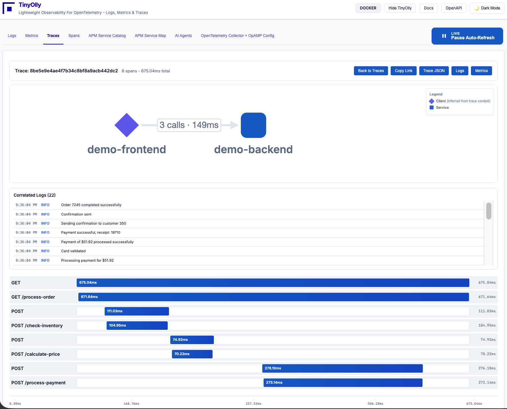
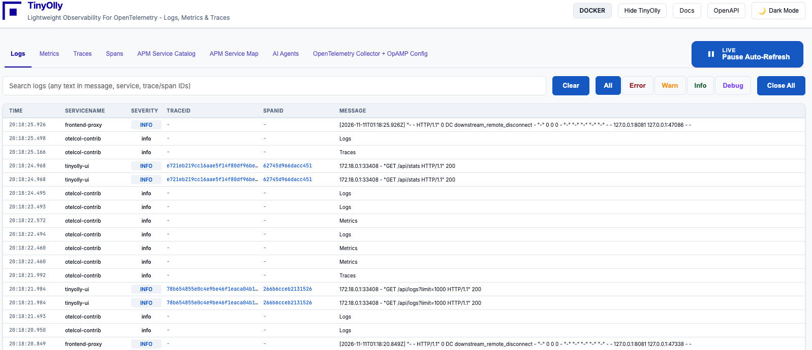
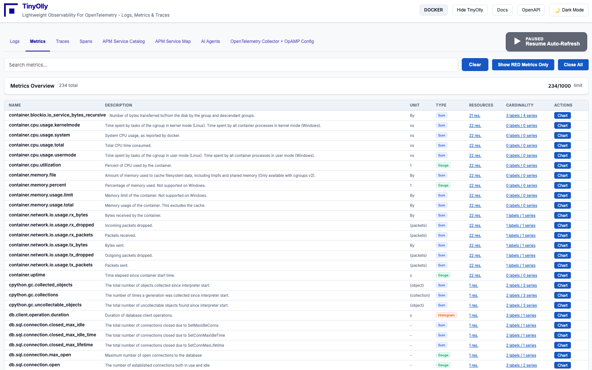
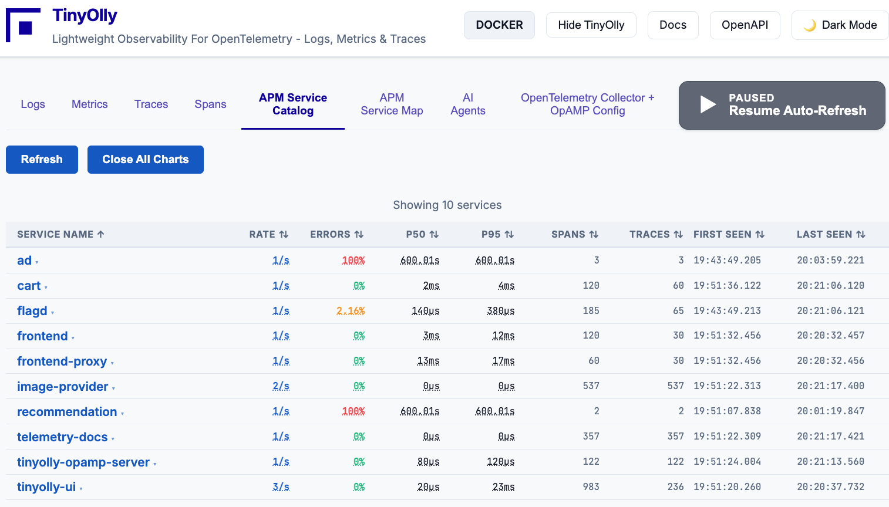
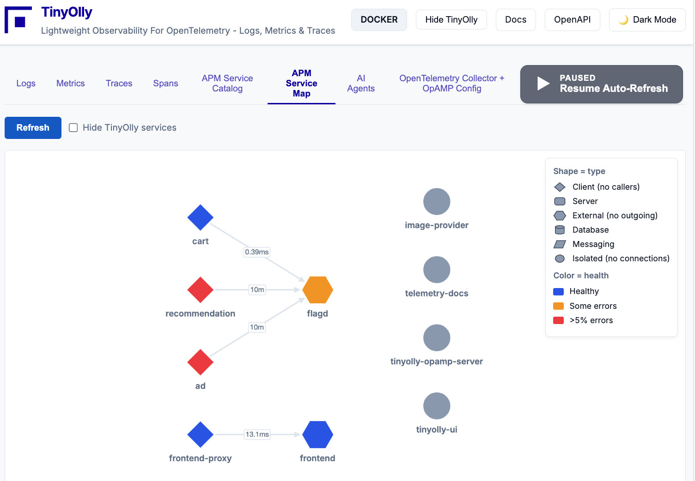
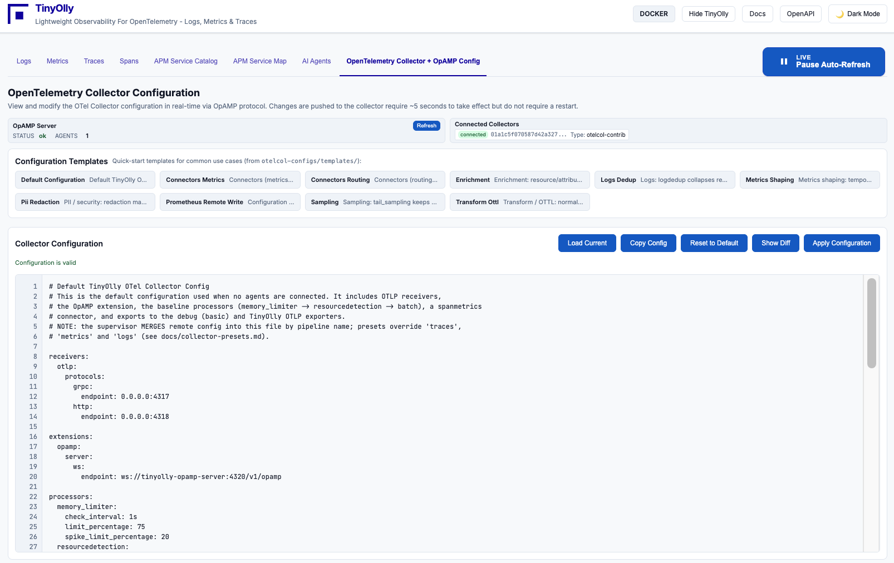

<div align="center">
  <br>
  <b>The World's First Desktop Observability Platform</b>
</div>  

---

## Introducing TinyOlly

**Repository:** [https://github.com/tinyolly/tinyolly](https://github.com/tinyolly/tinyolly)

```bash
git clone https://github.com/tinyolly/tinyolly
```

### Why TinyOlly?

Why send telemetry to a cloud observability platform while coding? Why not have one on your desktop?

TinyOlly is a **lightweight OpenTelemetry-native observability platform** built from scratch to visualize and correlate logs, metrics, and traces. No 3rd party observability tools - just Python (FastAPI), SQLite, OpenAPI, and JavaScript.

### Key Features

- **Development-focused** - Perfect your app's telemetry locally before production
- **Full OpenTelemetry support** - Native OTLP ingestion (gRPC & HTTP)
- **Pre-built Docker images** - Deploy in ~30 seconds from Docker Hub
- **Runs on Colima** - Docker and kind (Kubernetes) on Apple Silicon Macs, no Docker Desktop required
- **Trace correlation** - Link logs, metrics, and traces automatically
- **Click-to-copy IDs** - Copy trace/span IDs with a single click anywhere in the UI
- **Deep linking** - Shareable URLs that open directly to a specific trace (`?tab=traces&traceId=...`)
- **Trace map** - Per-trace service dependency visualization with inferred external client detection
- **Correlated log navigation** - Jump from trace detail to filtered logs and vice versa
- **Smart auto-refresh** - Auto-refresh pauses when search filters are active, no more losing results
- **Bounded retention** - Data expires after 30 minutes by default (`SQLITE_TTL_SECONDS`) and the database is capped at 256 MB (`MAX_DB_SIZE_MB`), oldest first
- **Metrics Explorer** - Analyze cardinality, labels, and raw series data
- **Service catalog** - RED metrics (Rate, Errors, Duration) for all services; click a service name to jump to its map node, traces, spans, logs or metrics
- **Interactive service map** - Dependency graph that always fits the window: shape shows service type (server, client, external, database, messaging, isolated), color shows health
- **MCP server** - Let Claude Code, Zed or any MCP client query your telemetry, including very large traces ([MCP guide](mcp.md))
- **Collector presets** - Sampling, PII redaction, enrichment, metrics shaping and more, applied from the UI via OpAMP
- **OpenTelemetry Demo** - Run the upstream Astronomy Shop against TinyOlly with one script
- **OpenTelemetry Collector management** - Remote configuration management via OpAMP protocol
- **REST API** - Programmatic access with OpenAPI documentation
- **Zero vendor lock-in** - Works with any OTel Collector distribution

!!! note "Local Development Only"
    TinyOlly is *not* designed to compete with production observability platforms! It's for local development only and is not focused on infrastructure monitoring at this time.

### Platform Support

Tested on:

- Docker via Colima (macOS Apple Silicon)
- kind on Colima (macOS Apple Silicon)
- May work on other platforms

### Quick Start

Ready to try TinyOlly? Check out the [Quick Start Guide](quickstart.md) to get running in under 5 minutes!

---

## Screenshots

<div align="center">
  <table>
    <tr>
      <td align="center" width="33%">
        <br>
        <em>Trace Waterfall with Correlated Logs</em>
      </td>
      <td align="center" width="33%">
        <br>
        <em>Real-time Logs with Filtering</em>
      </td>
      <td align="center" width="33%">
        <br>
        <em>Metrics with Chart Visualization</em>
      </td>
    </tr>
    <tr>
      <td align="center" width="33%">
        <br>
        <em>Service Catalog with RED Metrics</em>
      </td>
      <td align="center" width="33%">
        <br>
        <em>Interactive Service Dependency Map</em>
      </td>
      <td align="center" width="33%">
        <br>
        <em>OTel Collector Configuration (OpAMP)</em>
      </td>
    </tr>
  </table>
</div>

---

<div align="center">
  <p>Built for the OpenTelemetry community</p>
  <p>
    <a href="https://github.com/tinyolly/tinyolly">GitHub</a> •
    <a href="https://github.com/tinyolly/tinyolly/issues">Issues</a>
  </p>
</div>

