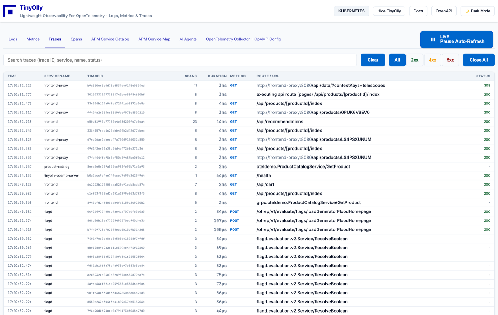
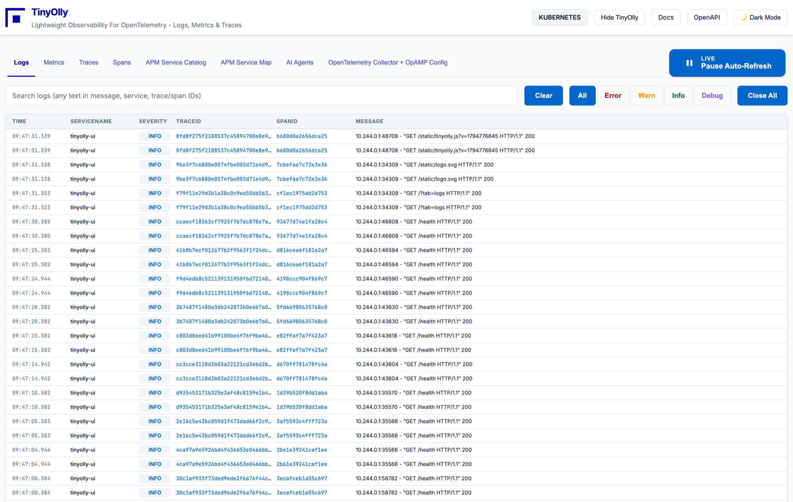
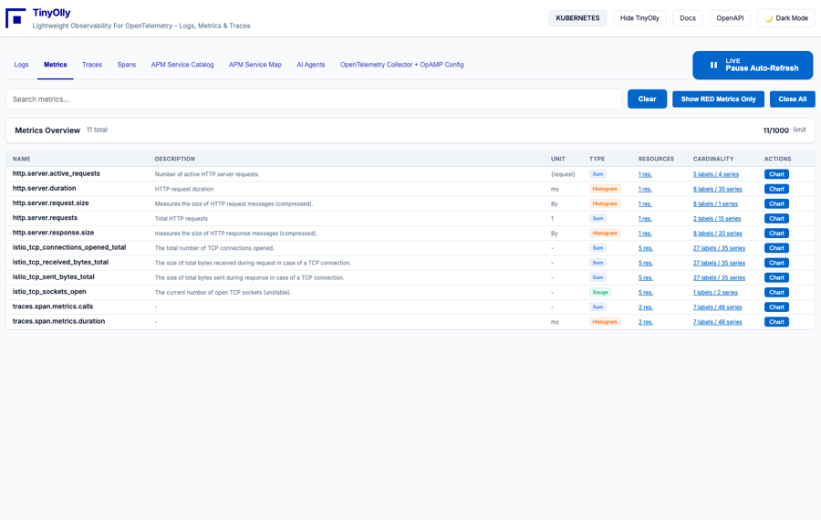
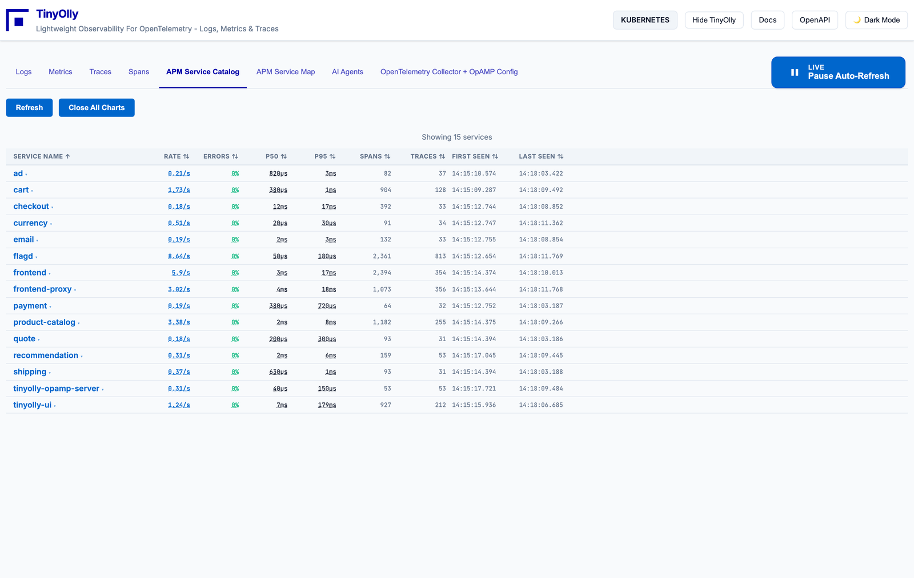
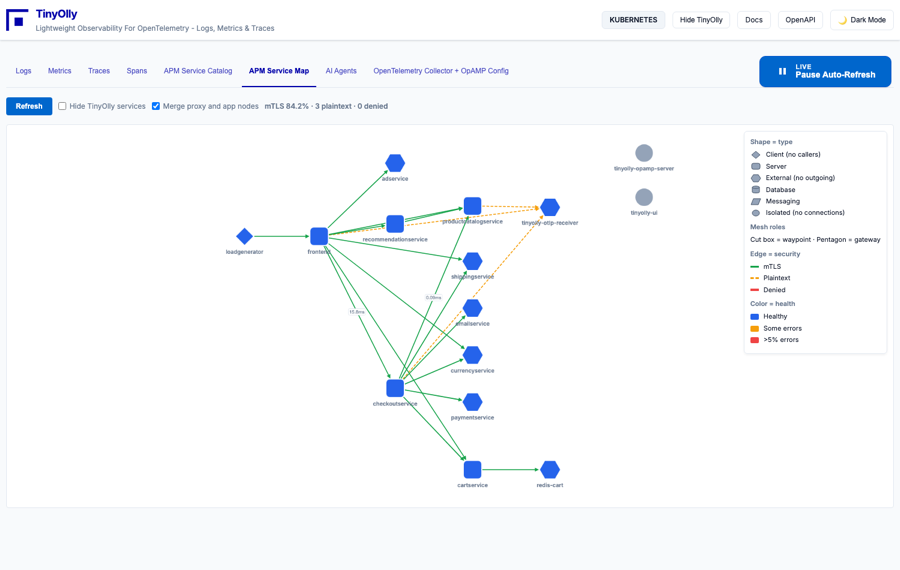
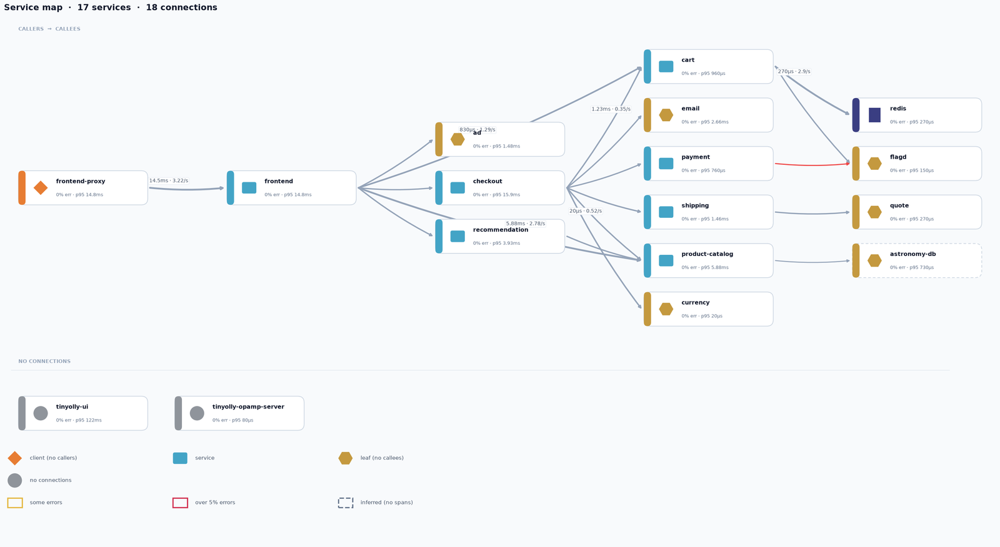
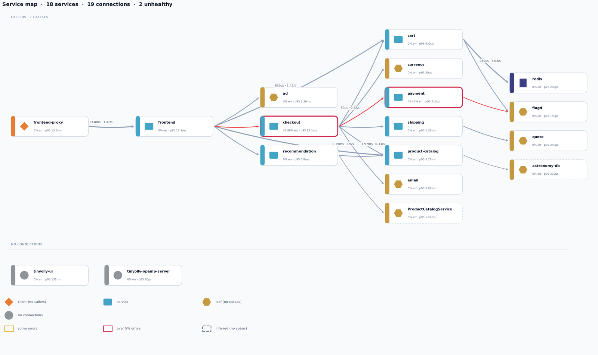
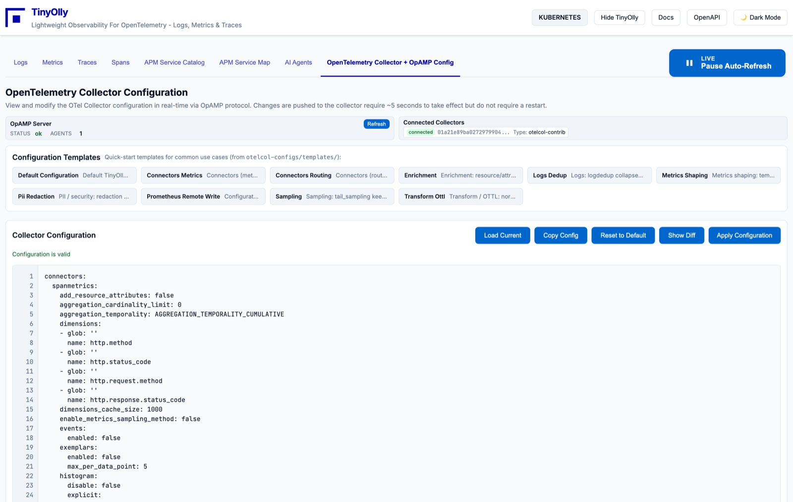

<div align="center">
  <br>
  <b>The World's First Desktop Observability Platform</b>
</div>  

---

## Introducing TinyOlly

**Repository:** [https://github.com/tinyolly/tinyolly](https://github.com/tinyolly/tinyolly)

```bash
git clone https://github.com/tinyolly/tinyolly
```

### Why TinyOlly?

Why send telemetry to a cloud observability platform while coding? Why not have one on your desktop?

TinyOlly is a **lightweight OpenTelemetry-native observability platform** built from scratch to visualize and correlate logs, metrics, and traces. No 3rd party observability tools - just Python (FastAPI), SQLite, OpenAPI, and JavaScript.

### Key Features

*Ingest & compatibility*
- Native OTLP over gRPC and HTTP; works with any OTel Collector distro
- Runs on Kubernetes (kind) in Colima on Apple Silicon, no Docker Desktop; pre-built images on Docker Hub
- Bounded retention: 30-minute TTL and 256 MB database cap, both configurable

*Explore your telemetry*
- Service catalog with RED metrics, and an interactive service dependency map
- Distributed trace waterfall with correlated logs and a per-trace service map
- Metrics Explorer with cardinality analysis and raw series
- Deep links and click-to-copy IDs: share a URL that opens straight to a trace or span

*Collector control*
- Collector presets applied from the UI via OpAMP: tail sampling, PII redaction, OTTL transforms, enrichment, metrics shaping, log dedup, derived-metric and routing connectors ([docs](collector-presets.md))

*AI & automation*
- MCP server: Claude Code, Zed or any MCP client can query traces, logs and metrics, render charts, and follow built-in investigation skills ([docs](mcp.md))
- REST API with OpenAPI documentation

*Demos*
- Realistic demo: the upstream OpenTelemetry Demo (Astronomy Shop) with failure-injection flags ([docs](otel-demo.md), [scenarios](scenarios.md))
- TinyOlly AI SRE Agent: an agent on shift over the shop that triages, investigates, proposes fixes and writes postmortems, scored against injected faults ([docs](ai-sre.md))

*Built with* Python (FastAPI), SQLite and JavaScript.

!!! note "Local Development Only"
    TinyOlly is *not* designed to compete with production observability platforms! It's for local development only and is not focused on infrastructure monitoring at this time.

### Platform Support

Tested on:

- kind on Colima (macOS Apple Silicon, 24 GB or more)
- May work on other platforms

### Quick Start

Four short steps, each adding to the last:

1. [Quick Start](quickstart.md): TinyOlly running
2. [Add the Demo](otel-demo.md): a real shop sending telemetry
3. [Add AI SRE](ai-sre.md): an agent watching it
4. [Create Scenarios](scenarios.md): break things and let the agent find them

---

## Screenshots

<div align="center">
  <table>
    <tr>
      <td align="center" width="50%">
        <a href="images/full/ui-traces.png"></a><br>
        <em>Trace waterfall with correlated logs</em>
      </td>
      <td align="center" width="50%">
        <a href="images/full/ui-logs.png"></a><br>
        <em>Real-time logs with trace and span linking</em>
      </td>
    </tr>
    <tr>
      <td align="center" width="50%">
        <a href="images/full/ui-metrics.png"></a><br>
        <em>Metrics with chart visualization</em>
      </td>
      <td align="center" width="50%">
        <a href="images/full/ui-service-catalog.png"></a><br>
        <em>Service catalog with RED metrics</em>
      </td>
    </tr>
    <tr>
      <td align="center" width="50%">
        <a href="images/full/ui-service-map.png"></a><br>
        <em>Service map of the OpenTelemetry Demo</em>
      </td>
      <td align="center" width="50%">
        <a href="images/full/mesh-otel-service-map.png"></a><br>
        <em>The same map drawn by the MCP server</em>
      </td>
    </tr>
    <tr>
      <td align="center" width="50%">
        <a href="images/full/mesh-otel-failure-map.png"></a><br>
        <em>After a fault: failing services outlined in red</em>
      </td>
      <td align="center" width="50%">
        <a href="images/full/ui-collector.png"></a><br>
        <em>OpenTelemetry Collector configuration (OpAMP)</em>
      </td>
    </tr>
  </table>
  <sub>Click a screenshot to enlarge.</sub>
</div>

---

<div align="center">
  <p>Built for the OpenTelemetry community</p>
  <p>
    <a href="https://github.com/tinyolly/tinyolly">GitHub</a> •
    <a href="https://github.com/tinyolly/tinyolly/issues">Issues</a>
  </p>
</div>

