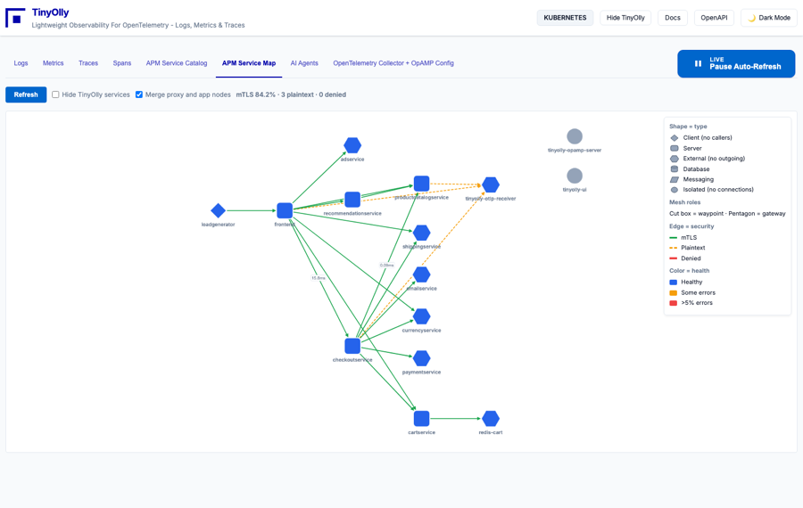

# Istio Ambient Mesh

TinyOlly can show an [Istio ambient](https://istio.io/latest/docs/ambient/) mesh (no sidecars) on the service map. The ambient data plane splits in two:

- **ztunnel** (one per node) gives every pod mTLS and L4 metrics, but emits **no traces**.
- **Waypoint** (optional Envoy per namespace or service) adds L7 features and emits traces, access logs and request metrics.

Because ztunnel produces only metrics, TinyOlly builds map edges from Istio metrics as well as from traces.

!!! tip "Runnable demo"
    The [istio-ambient-demo](https://github.com/stevelerner/istio-ambient-demo) repo installs Istio ambient on a local kind cluster, deploys Online Boutique, and has scenarios for waypoint, fault injection, retries and authorization policy. It is a separate repo so TinyOlly stays small.

## What you get on the map

| Feature | How it shows |
|---|---|
| Topology without traces | Edges from `istio_tcp_connections_opened_total` and `istio_requests_total` (`source_kind: metrics`) |
| mTLS posture | Green edges are mutual TLS, orange dashed edges are plaintext; the bar above the map shows `mTLS 92.5% · 3 plaintext · 1 denied` |
| Denied calls | Red thick edge. Counted from HTTP 403, gRPC status 7 (PERMISSION_DENIED), waypoint local replies, and L4 connections ztunnel refuses (`response_flags=DENY`, e.g. plaintext into a STRICT mTLS namespace) |
| Mesh roles | Waypoint (cut box) and gateway (pentagon) node shapes |
| Merged vs Layered | `waypoint.boutique` (trace identity) and `waypoint` (metric identity) merge into one node; untick **Merge proxy and app nodes** to see both |

The same data is available from `GET /api/service-map` and `GET /api/mesh-posture` ([API reference](api.md)) and the `get_service_map` / `get_mesh_posture` MCP tools ([MCP](mcp.md)).

## Getting the data in

1. **Metrics:** scrape ztunnel and the waypoint (Prometheus port `15020`) with an OpenTelemetry Collector `prometheus` receiver and forward the `istio_*` metrics to TinyOlly's OTLP receiver. The demo repo has a ready `mesh-metrics.yaml`.
2. **Traces (optional):** register an OpenTelemetry extension provider in Istio and enable it with a `Telemetry` resource on the waypoint; the app's own spans stitch into the same traces if the app exports to TinyOlly too.
3. Name your services consistently: edges from metrics use Istio's `source_canonical_service` / `destination_canonical_service` labels, so set `OTEL_SERVICE_NAME` in the app to the same name to join metric and trace edges.

## Good to know

- **Namespace merge:** a name like `waypoint.boutique` is merged into `waypoint` only when `boutique` appears as a workload namespace in the mesh metrics.
- **Denial detection is heuristic:** a gRPC call denied by an authorization policy returns HTTP 200 with `grpc-status: 7`, and a waypoint local reply shows up with no upstream workload. TinyOlly treats both as denied, and also connections ztunnel marks `DENY`. Calls that fail upstream with a response flag (for example `UH`) count as errors, not denials.
- **Plaintext edges** are normal for non-mesh traffic such as apps exporting telemetry to TinyOlly.
- **History persists:** ztunnel counters count from when ztunnel started, so TinyOlly shows denied and plaintext history from before a demo began. Restart ztunnel and clear TinyOlly's stored telemetry (`POST /admin/reset`) for a clean start.
- **Why did it break?** `get_edge` decodes the response flags an edge carries (`UC`, `UT`, `DI`, `DENY`...) with a meaning and a next step, and `what_changed` lines up change markers (`POST /api/events`, which the demo's scenario script posts) with the failures and traffic around them.
- **Seeing the mesh:** the map fades edges that only have connection counts (L4) when others have request data, shows each service's cluster and marks edges that cross clusters when the metrics carry cluster labels, and `chart_map_diff` / `chart_trace_path` show what changed and where one request spent its time. `get_mesh_posture` reports L7 coverage and the L4-only edges.
- **Reconnect after adding a waypoint:** long-lived gRPC connections keep the path they were opened on, so a waypoint sees no traffic until callers reconnect (for example by restarting them).
- **Timeouts and delays:** a route timeout does not cut off a fault delay injected by the mesh; it only cuts off real upstream slowness.
