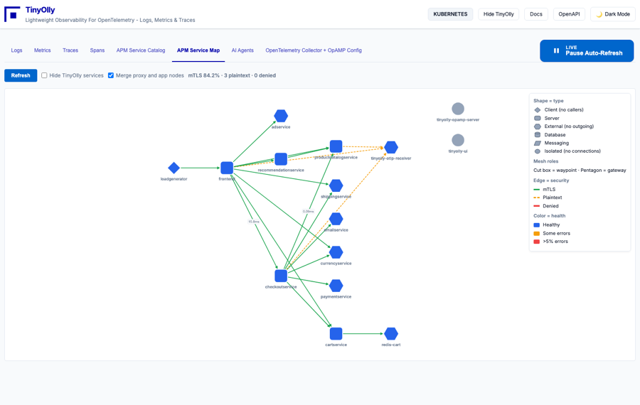

# Kubernetes Deployment

TinyOlly on kind (Kubernetes in Colima), for local development.

<div align="center">
  <a href="../images/full/ui-service-map.png"></a>
  <p><em>Service map of the OpenTelemetry Demo on kind</em></p>
</div>

Run everything from the repo (clone it, or download the current GitHub release archive):
```bash
git clone https://github.com/tinyolly/tinyolly
```

## Prerequisites

[Colima](https://github.com/abiosoft/colima), `docker`, [kind](https://kind.sigs.k8s.io/), [kubectl](https://kubernetes.io/docs/tasks/tools/), [Helm](https://helm.sh/docs/intro/install/):

```bash
brew install colima docker docker-compose docker-buildx docker-credential-helper kubectl kind helm
```

## 1. Deploy TinyOlly core

```bash
./scripts/colima-up.sh   # defaults: 4 CPU / 4 GB (COLIMA_MEMORY=8 for more)
./scripts/kind-up.sh
```

Deploy (images come from Docker Hub):

```bash
./k8s/02-deploy-tinyolly.sh
```

or apply the manifests yourself (not `kubectl apply -f k8s/`: that skips the collector ConfigMaps in `k8s/otelcol-configs/` and also deploys the AI SRE Agent):

```bash
kubectl apply -R -f k8s/otelcol-configs/
kubectl apply -f k8s/tinyolly-sqlite-pvc.yaml -f k8s/tinyolly-otlp-receiver.yaml -f k8s/tinyolly-opamp-server.yaml \
  -f k8s/otel-collector.yaml -f k8s/tinyolly-ui.yaml -f k8s/tinyolly-mcp.yaml
```

!!! note "Local build"
    To build the images from your checkout and load them into kind:
    ```bash
    ./build/local/build-core-kind.sh
    ```

`scripts/kind-config.yaml` maps the NodePorts to your host, so no port-forward is needed:

- UI: [http://localhost:5005](http://localhost:5005), including the **OpenTelemetry Collector + OpAMP Config** tab ([setup](#opamp-configuration-optional)).
- [MCP server](mcp-deploy.md) for AI agents: `http://localhost:8765/mcp` (rebuild with `k8s/05-rebuild+deploy-mcp.sh`).
- OTLP from host apps: `http://localhost:4317` (gRPC), `http://localhost:4318` (HTTP). From inside the cluster: `otel-collector:4317` / `otel-collector:4318`.

These host ports are shared with the Docker stack, so run one or the other.

```bash
export OTEL_EXPORTER_OTLP_ENDPOINT=http://localhost:4318
```

Clean up TinyOlly, then the cluster and the VM:

```bash
./k8s/03-cleanup.sh
```

```bash
kind delete cluster --name tinyolly
colima stop -p tinyolly
```

## 2. OpenTelemetry Demo (Astronomy Shop)

The [OpenTelemetry Demo](https://opentelemetry.io/docs/demo/) via Helm, sending to TinyOlly's collector (its Jaeger, Grafana and Prometheus are disabled). Deploy TinyOlly first and give the VM enough memory (about 8 GB; 12 GB with the AI SRE Agent):

```bash
./k8s-otel-demo/01-deploy-otel-demo-helm.sh
```

Tested end to end on kind with the [TinyOlly AI SRE Agent](ai-sre.md): `k8s/06-rebuild+deploy-sre.sh --demo` adds the agent and its demo shift, which flips the shop's feature flags through flagd-ui. Remove the demo (TinyOlly keeps running):

```bash
./k8s-otel-demo/02-cleanup-otel-demo-helm.sh
```

## 3. TinyOlly **Core-Only** Deployment: Use Your Own Kubernetes OpenTelemetry Collector

TinyOlly without its collector (for example next to an existing collector DaemonSet), with the OpAMP server for remote config. The UI is on `http://localhost:5005`.

```bash
cd misc/k8s-core-only
./01-deploy.sh
```

```bash
./02-cleanup.sh
```

### Use TinyOlly with any OpenTelemetry Collector

Point any collector distribution's exporter at `tinyolly-otlp-receiver:4343`, for example:
```yaml
exporters:
  debug:
    verbosity: detailed
  
  otlp:
    endpoint: "tinyolly-otlp-receiver:4343"
    tls:
      insecure: true
    # Batching lives in the exporter's queue; the batch processor is deprecated (removed in collector v0.177.0).
    sending_queue:
      batch:
        enabled: true

service:
  pipelines:
    traces:
      receivers: [otlp]
      exporters: [debug, otlp, spanmetrics]
    
    metrics:
      receivers: [otlp,spanmetrics]
      exporters: [debug, otlp]
    
    logs:
      receivers: [otlp]
      exporters: [debug, otlp]
```

## OpAMP Configuration (Optional)

To manage a collector from the UI's **OpenTelemetry Collector + OpAMP Config** page, add the OpAMP extension:

```yaml
extensions:
  opamp:
    server:
      ws:
        endpoint: ws://tinyolly-opamp-server:4320/v1/opamp

service:
  extensions: [opamp]
```

A complete example (OTLP receivers, OpAMP, exporter-side batching, spanmetrics) is the default template in the ConfigMap in `misc/k8s-core-only/tinyolly-opamp-server.yaml`.

## Testing this setup

`./scripts/test-kind.sh` creates a throwaway kind cluster, deploys core-only and the full core, checks the UI, OpAMP and OTLP ingestion, and deletes the cluster. It briefly stops the Docker stack (both use ports 5005/4317/4318).

## Building Images

Deploy scripts pull images from Docker Hub. To build locally or publish, see [Development and testing](development.md#building-and-publishing-images) and [build/README.md](https://github.com/tinyolly/tinyolly/blob/main/build/README.md).
