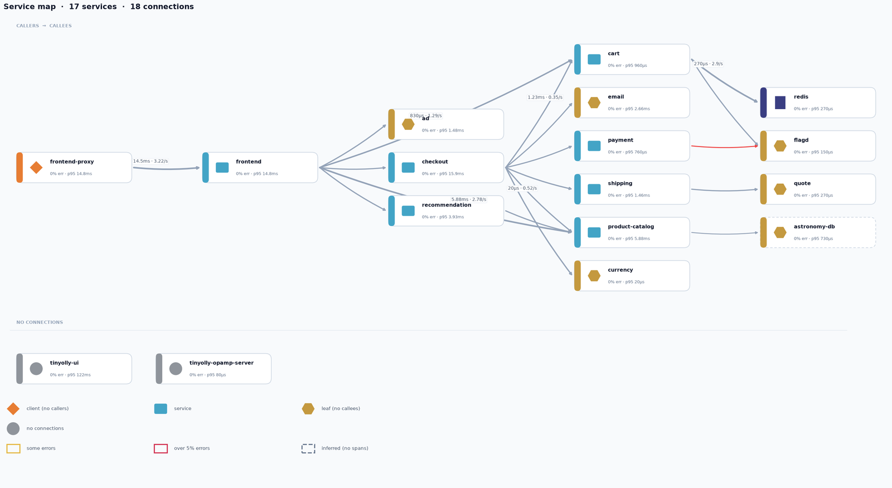
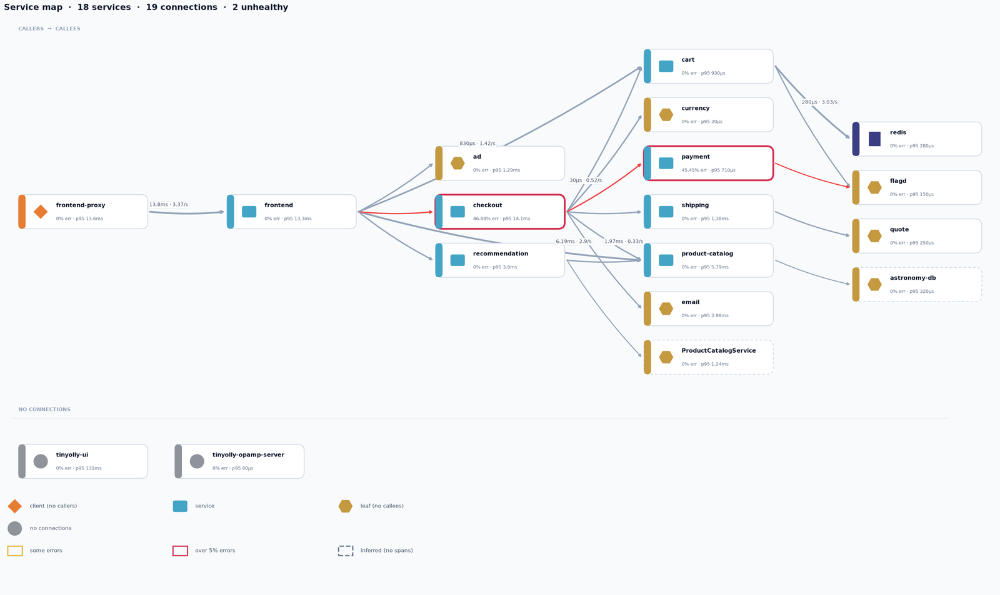
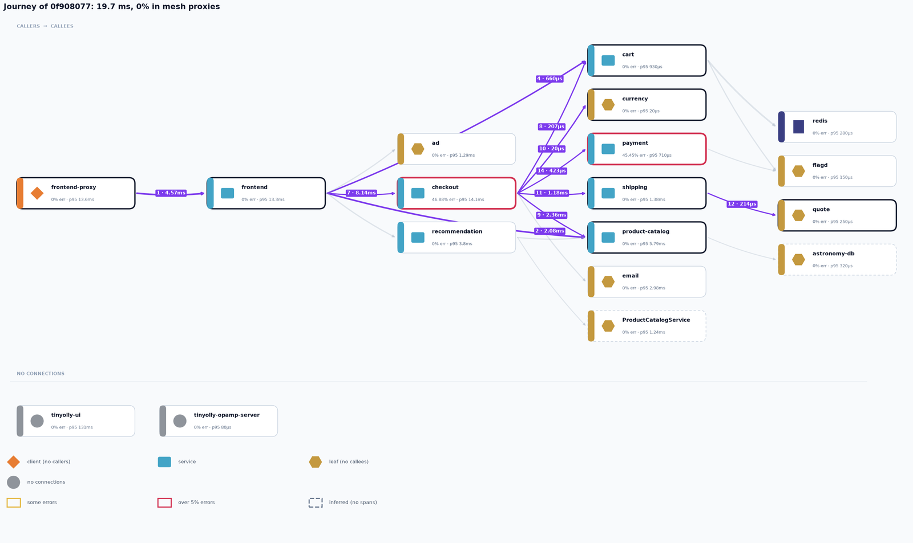

# MCP server (AI agents)

`docker/apps/tinyolly-mcp` is a **read-only** [MCP](https://modelcontextprotocol.io) server. Claude Code, Zed or any MCP client can query your running TinyOlly (traces, spans, logs, metrics, service catalog and map) and read these docs. It has no collector config or admin operations.

## Install

1. Start TinyOlly (UI on [http://localhost:5005](http://localhost:5005)).
2. Run the installer. It creates a venv and prints the lines to copy for your client, with your paths filled in:

    ```bash
    docker/apps/tinyolly-mcp/install.sh
    ```

3. Connect your client:

| Client | What to do |
|---|---|
| **Claude Code** | Paste the `claude mcp add tinyolly -- ...` line the installer printed. |
| **Claude Desktop** | Paste the `"tinyolly": {...}` entry under `"mcpServers"` in `~/Library/Application Support/Claude/claude_desktop_config.json` (Settings, Developer, Edit Config), then quit (Cmd+Q) and reopen Claude. |
| **Zed** | Paste the `context_servers` entry into `~/.config/zed/settings.json`. |

The client starts the server itself. Check it with "pretty print the service catalog".

!!! note "Why not just a URL?"
    Claude Desktop's URL connectors are called from Anthropic's cloud, which cannot reach `localhost`, so the client starts a local server instead.

### Always-on server (Docker or Kubernetes)

TinyOlly's Docker and Kubernetes deployments also run the server as a container on `http://localhost:8765/mcp`, shared by every client. See the [MCP Server deployment page](mcp-deploy.md).

## Tools

| Tool | What it does |
|---|---|
| `list_services` | Service catalog: rate, error rate, p50/p95/p99, worst errors first (`format="table"` for a table) |
| `get_service_map` | Caller → callee edges with calls, errors, p95. With Istio: node `role`, edge `mtls`, `source_kind`, `denied_count`; `merge=False` for the layered view. Filters: `service`, `only` (`denied`, `plaintext`, `errors`), `limit` |
| `get_mesh_posture` | Istio posture: mTLS coverage %, plaintext edges, denied calls |
| `find_denied`, `find_plaintext` | Only the denied or non-mTLS edges |
| `get_edge` | One edge in detail: RED numbers of both services and the Envoy/ztunnel response flags (UC, UT, DI, DENY...) with their meaning and a next step |
| `get_trace_mesh` | Mesh view of a trace: proxy time per hop, retries, decoded response flags |
| `get_version_split` | Canary view: traffic share, error rate and `avg_ms` per version, with `findings` when one version is slower or fails more |
| `what_changed` | Change markers (deploys, policies, scenarios; `POST /api/events`) and how failures, response flags and traffic changed around each |
| `suggest_authz` | Draft least-privilege ALLOW `AuthorizationPolicy` from the callers seen (SPIFFE identities), listing plaintext callers it would block. Review before applying |
| `chart_map_diff` | The map coloured by what changed around the latest change marker (red: more failures, teal: fewer, blue: new or busier, grey: quieter) |
| `chart_trace_path` | One trace over the map: numbered hops with time in each, and mesh-proxy time versus app time |
| `compare_windows` | Last N minutes vs the N before: new, gone, more errors, slower |
| `search_traces` | Recent traces by service (any span from it), errors, min duration, root name (`format="table"`) |
| `get_trace` | **Bounded summary** of a trace: duration, counts, per-service breakdown, error and slowest spans. `format="waterfall"` draws a text waterfall |
| `get_trace_spans` | Page through a trace's spans (offset/limit, service/error/duration filters) |
| `get_span` | One span in full (attributes, events, links, resource) |
| `search_spans` | Recent spans by service, errors, duration, name (`format="table"`) |
| `query_logs` | Logs by trace, service, severity, substring (`format="table"`) |
| `list_metrics` | Metric names, with a search filter |
| `query_metric` | Time series for the last N minutes, downsampled (min/max/avg/last). `labels` filters on attributes; `group_by` sums per attribute value |
| `chart_metric` | **Image**: line chart of a metric (histograms: mean solid, p95 dashed) |
| `chart_service_map` | **Image**: the whole map, or with `service` one service's callers (left) and callees (right), coloured by health, edges labelled with p95 and rate (`depth=2` for two hops) |
| `list_skills`, `get_skill` | Investigation playbooks, and the full steps of one |
| `list_docs`, `search_docs`, `read_doc` | These docs: list pages, search sections, read a page or one section |

The docs are also MCP resources: `tinyolly-docs://<name>` (for example `tinyolly-docs://quickstart`).

## Pretty output and charts

JSON output is compact for agents. To show a person, pass `format="table"` (catalog, traces, spans, logs) or `format="waterfall"` on `get_trace` (span tree with timing bars; big traces keep every error span and the slowest, up to `max_rows`). `chart_metric` and `chart_service_map` return PNG images (drawn with matplotlib, installed by `install.sh`), so the client must display images; Claude Desktop and Claude Code do. Desktop shows a small preview: click to enlarge, or ask for a file with `save_to` ("save the service map to ~/Desktop/map.png").

`chart_service_map` draws each service as a card with a role icon, `err · p95`, and a health stripe (blue healthy, amber above 1% errors, red above 5%, grey no connections). With mesh data, edge colour shows security: green mTLS, amber dashed plaintext, red denied or errors, grey unknown. Only the six busiest edges carry latency labels on the whole map.

[](images/full/mesh-otel-service-map.png)

During a fault the failing services turn red, and `chart_trace_path` draws one request's journey hop by hop. `chart_map_diff` needs a mesh: it reads Istio request metrics.

[](images/full/mesh-otel-failure-map.png)

[](images/full/mesh-otel-trace-path.png)

Try: "show me the service map", "draw the service map around cart", "show the slowest checkout trace as a waterfall", "chart http.server.duration for tinyolly-ui".

## Investigation skills

Seven short playbooks live inside the server (`docker/apps/tinyolly-mcp/skills/`); nothing is installed into the client.

| Skill | Use it for |
|---|---|
| `tinyolly-triage` | "What is wrong right now?": rank services, find a failing trace, report where/what/evidence/next |
| `tinyolly-trace-investigation` | One trace: summary, waterfall, paging huge traces, self-time vs first error |
| `tinyolly-service-deep-dive` | One service: vitals, dependencies, errors, slow traces, logs, metrics |
| `tinyolly-metrics-explorer` | Finding, charting and reading metrics (counters, gauges, histograms, cardinality) |
| `tinyolly-troubleshoot-stack` | TinyOlly empty or unreachable (Colima contexts, ports, retention), setup questions |
| `tinyolly-mesh-investigation` | Istio mesh: mTLS posture, denied and plaintext edges, mesh time and retries, version split, what changed |
| `tinyolly-demo-failure-injection` | Break the OTel demo with a feature flag and watch TinyOlly catch it |

They are offered as tools (`list_skills`, `get_skill(name)`; the server tells agents to call `list_skills` first), as prompts with an optional `focus` argument (for example `tinyolly-triage` with focus "checkout is slow"), and as resources (`tinyolly-skills://<name>`). Tests check that every tool and parameter a skill names exists. To add one, create `skills/<name>.md` with `name` (the file name) and a `description` starting with "Use when".

## Docs

The server reads `docs/*.md` (`TINYOLLY_DOCS_DIR` overrides it), strips screenshots and HTML, flattens admonitions and tabs, and splits pages by heading so `read_doc(name, section)` returns only what is needed. `list_docs` shows each page's `title` and `description` front matter, so new pages need it.

Try: "how do I run the OpenTelemetry demo?", "which collector presets exist?", "what ports does TinyOlly use?".

## Large traces

Nothing returns an unbounded payload. Drill down: `search_traces` → `get_trace` (a few KB even for 6,000 spans) → `get_trace_spans` (pages of up to 200 rows) → `get_span`. Values and log bodies are truncated, series downsampled, and every response is capped at `TINYOLLY_MCP_MAX_CHARS` (default 20,000) with a `truncated` flag that tells the agent to narrow the query.

Try: "which services have the highest error rate?", "find the slowest checkout trace and tell me where the time went", "show error logs for the cart service".
