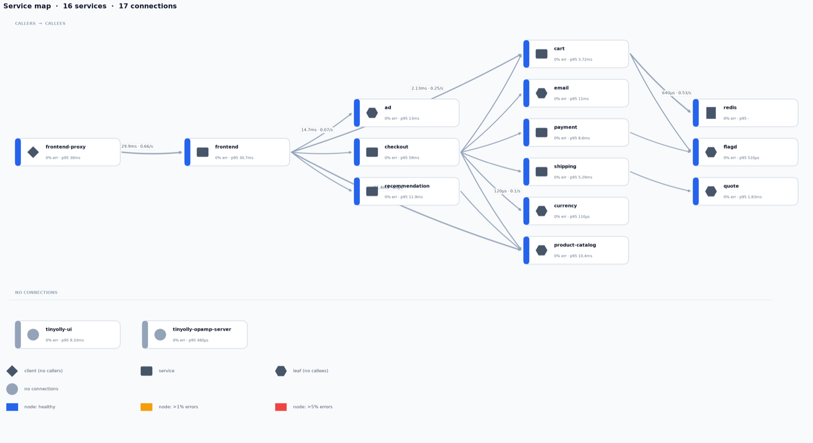
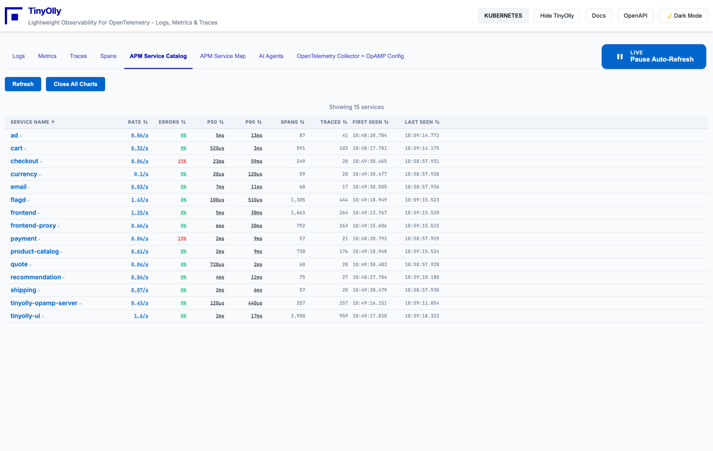
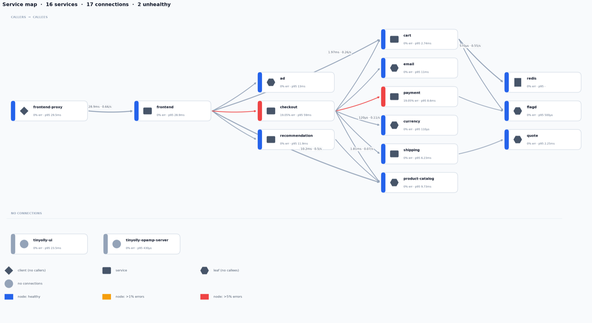
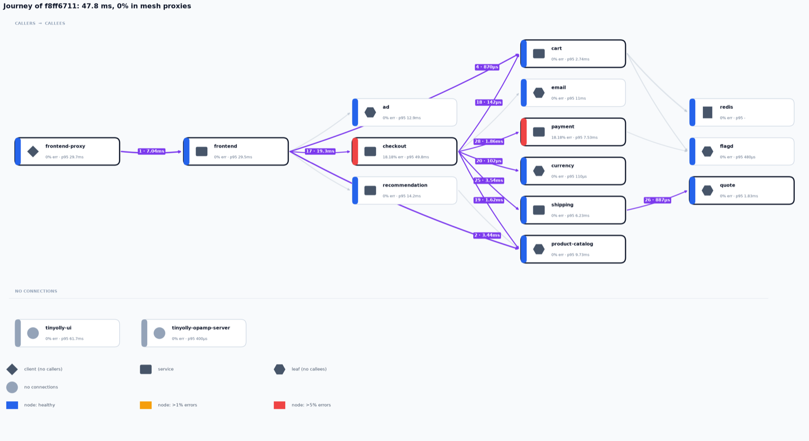

# Ask an AI about the OpenTelemetry Demo

The [OpenTelemetry Demo](otel-demo.md) is a good place to try TinyOlly's [MCP server](mcp.md): it has real services, real traces and logs, and failures you can switch on with a feature flag. Connect an assistant (Claude Code, Claude Desktop, Zed) and ask in plain English; it answers from TinyOlly's data instead of guessing.

**Before you start**

1. TinyOlly and the demo are running ([run the demo](otel-demo.md)), on Docker or kind.
2. The assistant is connected to the MCP server ([set up and connect it](mcp-deploy.md)): `http://localhost:8765/mcp`.
3. Ask it: "List the TinyOlly playbooks you have." You should see `tinyolly-demo-failure-injection`, the playbook for everything on this page.

[](images/full/mesh-otel-service-map.png)

## Prompts to try

The tool or playbook behind each prompt is on the right.

**Explore**

| Prompt | Tool |
|---|---|
| "What services are running, and how healthy are they?" | `list_services` |
| "Show me the service map." | `chart_service_map` |
| "Draw the neighbourhood of checkout, two hops out." | `chart_service_map` |
| "How does an order flow through the shop?" | `search_traces`, `get_trace` |

**Investigate a failure**

| Prompt | Tool |
|---|---|
| "Something is wrong with checkout. What is failing and why?" | `get_service_map` (errors only), `search_traces`, `get_trace` |
| "Show me a failing order as a waterfall." | `search_traces` (errors only), `get_trace` (waterfall) |
| "Draw the journey of that failing request over the map." | `chart_trace_path` |
| "Explain the edge from checkout to payment: errors, latency." | `get_edge` |
| "Break payments for me, then show how TinyOlly catches it." | `get_skill` → `tinyolly-demo-failure-injection` |

**Dig deeper**

| Prompt | Tool |
|---|---|
| "Find the slowest checkout traces and tell me where the time goes." | `search_traces`, `get_trace_spans` |
| "Show the attributes of the payment span in that trace." | `get_span` |
| "Group `traces.span.metrics.calls` by service and status." | `query_metric` |
| "Are any card numbers or emails visible in span attributes?" (with the `emitRawPii` flag on) | `search_spans`, `get_span` |
| "Which metrics exist for the cart service?" | `list_metrics` |

**Learn the tool**

| Prompt | Tool |
|---|---|
| "How do I apply the PII redaction preset?" | `search_docs`, `read_doc` |
| "Which feature flags can I use to break the demo?" | `read_doc` |

## Worked example: payments start failing

This is a real run on kind, with the `paymentFailure` flag at 50%.

### 1. Break it

On Docker:

```bash
cd docker-otel-demo
./03-set-flag.sh paymentFailure 50%
```

On kind, edit the flag in the `flagd-config` ConfigMap and restart flagd (see [Kubernetes](otel-demo.md#kubernetes-kind)). Give it a minute or two for errors to show.

### 2. Ask what is wrong

> Something is wrong with checkout. What is failing and why?

The assistant starts with the whole system. TinyOlly's catalog shows the two services whose error rate jumped, and `get_service_map` with `only="errors"` returns just the failing path (trimmed here):

[](images/full/ui-otel-failure-catalog.png)

```json
{"nodes": [{"id": "frontend"}, {"id": "checkout"}, {"id": "payment"}],
 "edges": [{"source": "frontend", "target": "checkout", "error_count": 4, "p95": 59.03},
           {"source": "checkout", "target": "payment",  "error_count": 4, "p95": 8.6}]}
```

The picture makes it obvious which services are red:

[](images/full/mesh-otel-failure-map.png)

### 3. Look at a failing order

> Show me a failing order as a waterfall.

`search_traces` (errors only, service `payment`) finds the traces, then `get_trace` draws one. Only the spans with errors (`✗`) are shown here; the tool also shows the slowest spans and says how many it hid:

```text
Trace f8ff6711ece8e830e65a3142885cd309: 47.8ms, 100 spans, 7 errors, 9 services
  └ frontend-proxy: router frontend egress   │                   ▓▓▓▓▓▓▓▓▓▓▓▓▓▓▓▓▓│  21.9ms ✗
        └ frontend: executing api route (pa… │                   ▓▓▓▓▓▓▓▓▓▓▓▓▓▓▓▓▓│  21.2ms ✗
          └ frontend: grpc.oteldemo.Checkou… │                   ▓▓▓▓▓▓▓▓▓▓▓▓▓▓▓▓ │  20.8ms ✗
            └ checkout: oteldemo.CheckoutSe… │                    ▓▓▓▓▓▓▓▓▓▓▓▓▓▓▓ │  19.3ms ✗
              └ checkout: oteldemo.PaymentS… │                               ▓▓▓▓ │  5.09ms ✗
                └ payment: grpc.oteldemo.Pa… │                                 ▓▓ │  1.86ms ✗
                  └ payment: charge          │                                 ▓▓ │   902µs ✗
```

The failure starts in `payment: charge` and bubbles up through `checkout` and `frontend` to the proxy.

### 4. See the journey

> Draw the journey of that failing request over the map.

`chart_trace_path` marks each hop of the request in order, with the time spent, and the failing services in red:

[](images/full/mesh-otel-trace-path.png)

### 5. Confirm with the edge

> Explain the edge from checkout to payment.

`get_edge` reports an error rate of 18.18% on both ends of the edge and a p95 of about 7.5 ms on the payment side: the failures are fast, which points to payment rejecting charges rather than timing out.

### 6. Turn it off and check

```bash
./03-set-flag.sh --reset
```

Ask the same question a minute or two later. New orders stop failing (the error rate figure in the catalog decays as the window moves on).

## What the tools do not cover for this demo

`what_changed` and `chart_map_diff` compare Istio request metrics before and after a change marker, so they show nothing for the OpenTelemetry Demo, which has no mesh. Use the catalog, `get_service_map`, `search_traces` and `get_trace` as above. They work from traces.

## See also

- [Run the OpenTelemetry Demo](otel-demo.md): Docker and kind setup, failure flags
- [MCP tools and playbooks](mcp.md): every tool and playbook
- [Istio ambient demo](istio.md): the same ideas for a service mesh
