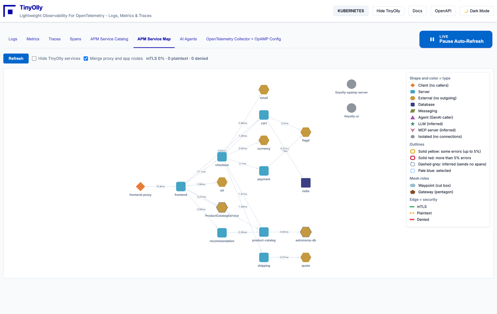

# 2. Add the Demo

This page adds the OpenTelemetry Demo (Astronomy Shop). It is a web shop of many services with a load generator, sending to TinyOlly.

```bash
./k8s-otel-demo/01-deploy-otel-demo-helm.sh
kubectl get pods
kubectl port-forward svc/frontend-proxy 8080:8080
```

The first run pulls images for a few minutes. Keep the port-forward running. The shop is at http://localhost:8080.

## What you should see

Within a couple of minutes, services, traces and the service map fill in at http://localhost:5005.

[](images/full/ui-otel-service-map.png)

A few errors in the first minutes are normal while pods start.

Next: [Add AI SRE](ai-sre.md)
