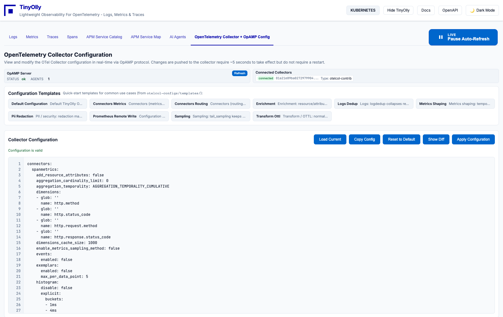

# Quick Start

Get TinyOlly running in under 5 minutes!

## What You'll Get

- **TinyOlly UI** at `http://localhost:5005`
- **OpenTelemetry Collector** listening on ports 4317 (gRPC) and 4318 (HTTP)
- **OpAMP Server** for remote collector configuration management
- **The OpenTelemetry Demo** (Astronomy Shop) sending real traces, logs and metrics

---

## Prerequisites

- Colima + docker CLI installed and running. The scripts use the `colima-tinyolly` Docker context, so they work even if another Docker context or VM is active:

    ```bash
    brew install colima docker docker-compose docker-buildx docker-credential-helper
    ./scripts/colima-up.sh
    ```

- Git (to clone the repository)
- 5 minutes of your time

---

## Step 1: Clone the Repository

```bash
git clone https://github.com/tinyolly/tinyolly
cd tinyolly
```

---

## Step 2: Start TinyOlly Core

```bash
cd docker
./01-start-core.sh
```

This pulls pre-built images from Docker Hub and starts:

- **OpenTelemetry Collector** (ports 4317/4318)
- **OpAMP Server** (ports 4320/4321)
- **TinyOlly OTLP Receiver** (internal)
- **TinyOlly UI** (port 5005)
- **TinyOlly MCP server** (port 8765, for AI agents: [MCP guide](mcp.md))
- **SQLite storage** (embedded)

**Deployment time:** ~30 seconds (pulls from Docker Hub)

**For local development:** Use `./01-start-core-local.sh` to build images locally.

---

## Step 3: Start the OpenTelemetry Demo

```bash
cd ../docker-otel-demo
./01-start-otel-demo.sh
```

This clones the upstream [OpenTelemetry Demo](otel-demo.md) at a pinned version and starts a 16-service subset of the Astronomy Shop
with a small load generator, all sending OTLP to TinyOlly. The first run pulls about 16 images.

**Wait a minute or two** for the services to appear. The shop itself is at `http://localhost:8080`.

To watch an AI SRE agent investigate faults in the shop as they happen, see the [TinyOlly AI SRE Agent](ai-sre.md).

---

## Step 4: Open the UI

Open your browser to: **`http://localhost:5005`**

You should see:

<div align="center">
  <a href="../images/full/ui-traces.png"></a>
  <p><em>Traces from the OpenTelemetry Demo</em></p>
</div>

---

## Step 5: Explore the Features

### Traces Tab
View distributed traces across microservices with timing waterfall.

Click a trace for its span waterfall with correlated logs; click a span for its full JSON.

### Logs Tab
Browse logs with trace/span correlation. Filter by severity (Error, Warn, Info, Debug).

<div align="center">
  <a href="../images/full/ui-logs.png"></a>
  <p><em>Logs with trace and span correlation</em></p>
</div>

Click a log entry for its full attributes; filter to errors to find failures fast.

### Metrics Tab
Visualize metrics with automatic charting.

<div align="center">
  <a href="../images/full/ui-metrics.png"></a>
  <p><em>Metrics explorer with charts and cardinality</em></p>
</div>

### Service Catalog
View all services with RED metrics (Rate, Errors, Duration). Click a service name for a menu that jumps to its map node, traces, spans, logs or metrics.

<div align="center">
  <a href="../images/full/ui-otel-catalog.png"></a>
  <p><em>Service catalog with RED metrics for all services</em></p>
</div>

### Service Map
Visualize service dependencies with an interactive graph. Shape shows the service type and color shows health (see the legend above the map); click a node for latency and a link to the Service Catalog, and use the checkbox to hide TinyOlly's own services.

<div align="center">
  <a href="../images/full/ui-otel-service-map.png"></a>
  <p><em>Interactive service dependency map with latency information</em></p>
</div>

### OpenTelemetry Collector + OpAMP Config
View and manage your OpenTelemetry Collector configuration remotely via the OpAMP protocol.

<div align="center">
  <a href="../images/collector.png"></a>
  <p><em>OpenTelemetry Collector configuration management via OpAMP</em></p>
</div>

This page allows you to:

- **View current configuration** from connected collectors
- **Apply configuration changes** with validation and diff preview
- **Use collector presets** for common scenarios (sampling, PII redaction, transforms, connectors, prometheus-remote-write...); see [Collector presets](collector-presets.md)
- **Check OpAMP server status** and see connected collector agents
- **Validate configurations** before applying to catch errors early

To use this feature, your OpenTelemetry Collector must be configured with the OpAMP extension (see [Docker Deployment](docker.md#opamp-configuration-optional) or [OpenTelemetry Collector](otel-collector.md#opamp-configuration-optional) documentation).

---

## Step 6: Use Your Own Application

Point your application's OpenTelemetry exporter to:

**For apps running on your host machine (outside Docker):**
```bash
export OTEL_EXPORTER_OTLP_ENDPOINT=http://localhost:4318
```

**For apps running inside Docker:**
```bash
export OTEL_EXPORTER_OTLP_ENDPOINT=http://otel-collector:4318
```

TinyOlly will automatically capture and display your telemetry!

---

## Cleanup

Stop the OpenTelemetry Demo (keeps TinyOlly running):
```bash
cd docker-otel-demo
./02-stop-otel-demo.sh
```

Stop everything:
```bash
cd docker
./02-stop-core.sh
```

---

## Next Steps

- [Configure your own OpenTelemetry Collector](otel-collector.md)
- [Explore the REST API](api.md) at `http://localhost:5005/docs`
- [Deploy on Kubernetes](kubernetes.md)
- [Learn about the architecture](technical.md)

---

## Troubleshooting

### UI shows "No traces/logs/metrics"
- Wait a minute or two after starting the OpenTelemetry Demo
- Check containers are running in the TinyOlly VM (plain `docker ps` shows whichever context is active, possibly another Colima VM):

    ```bash
    docker --context colima-tinyolly ps
    ```

- Check the demo's containers and the load generator:

    ```bash
    docker --context colima-tinyolly logs load-generator --tail 20
    ```

### Port conflicts
- TinyOlly uses ports 4317, 4318, 4320, 4321, 4343, 5005, 8765, 19291
- Stop conflicting services or modify ports in `docker-compose-tinyolly-core.yml`

### The shop is not generating traffic
- Restart the demo:

    ```bash
    cd docker-otel-demo
    ./02-stop-otel-demo.sh
    ./01-start-otel-demo.sh
    ```

For more help, [open an issue on GitHub](https://github.com/tinyolly/tinyolly/issues).
