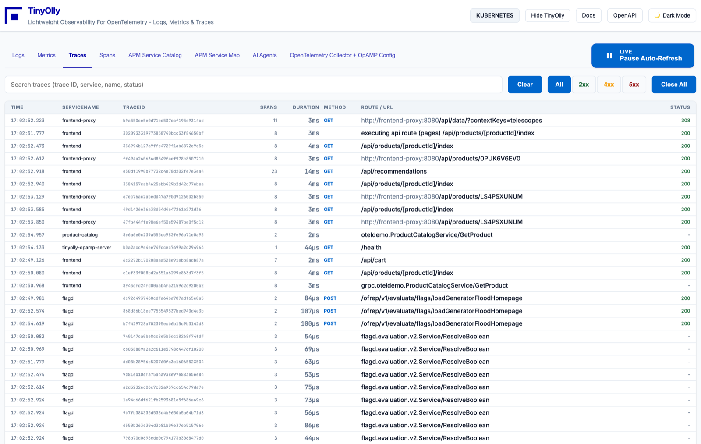
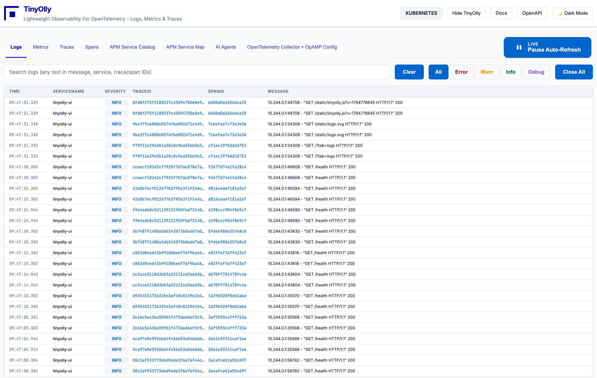
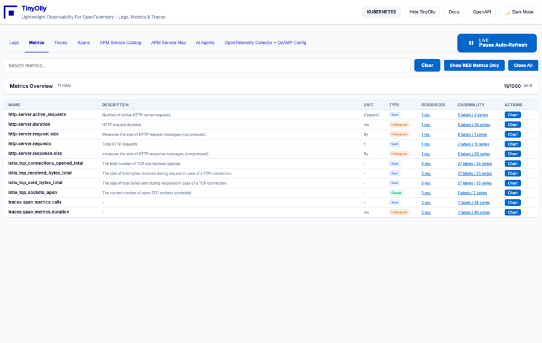
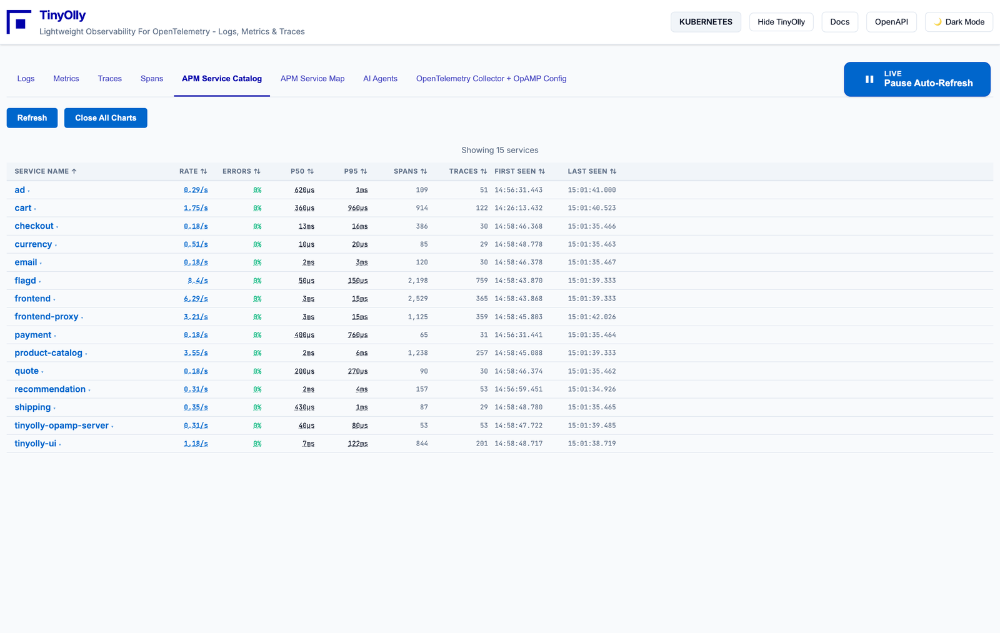
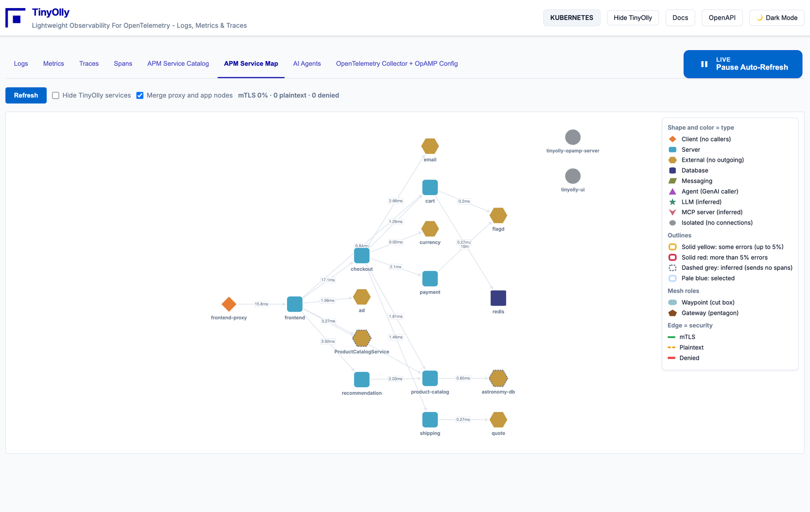
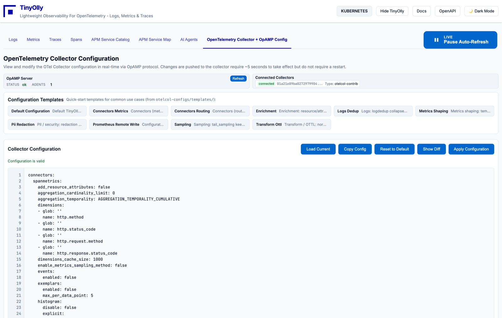

# Quick Start

Run TinyOlly and the OpenTelemetry Demo on your Mac in about five minutes: the UI on `http://localhost:5005`, an OpenTelemetry Collector on 4317 (gRPC) and 4318 (HTTP), an OpAMP server for collector config, and the Astronomy Shop sending real traces, logs and metrics.

## Prerequisites

Colima and the docker CLI. The scripts use the `colima-tinyolly` Docker context, so another active context or VM does not get in the way:

```bash
brew install colima docker docker-compose docker-buildx docker-credential-helper
./scripts/colima-up.sh
```

## 1. Clone

```bash
git clone https://github.com/tinyolly/tinyolly
cd tinyolly
```

## 2. Start TinyOlly core

```bash
cd docker
./01-start-core.sh
```

This pulls the images from Docker Hub (about 30 seconds) and starts the collector (4317/4318), the OpAMP server (4320/4321), the OTLP receiver, the UI (5005) and the [MCP server](mcp.md) (8765, for AI agents), with embedded SQLite storage. `./01-start-core-local.sh` builds the images from your checkout instead.

## 3. Start the OpenTelemetry Demo

```bash
cd ../docker-otel-demo
./01-start-otel-demo.sh
```

This starts a 16-service subset of the [OpenTelemetry Demo](otel-demo.md) and a small load generator, all sending to TinyOlly (the first run pulls about 16 images). Services appear within a minute or two; the shop is at `http://localhost:8080`. To have an AI SRE agent investigate faults in the shop as they happen, see the [TinyOlly AI SRE Agent](ai-sre.md).

## 4. Tour the UI

Open `http://localhost:5005`.

**Traces:** each trace's span waterfall with its correlated logs; click a span for its full JSON.

<div align="center">
  <a href="../images/full/ui-traces.png"></a>
</div>

**Logs:** linked to their trace and span, filterable by severity.

<div align="center">
  <a href="../images/full/ui-logs.png"></a>
</div>

**Metrics:** every metric with charts and cardinality.

<div align="center">
  <a href="../images/full/ui-metrics.png"></a>
</div>

**Service Catalog:** rate, errors and duration per service; click a name to jump to its map node, traces, spans, logs or metrics.

<div align="center">
  <a href="../images/full/ui-otel-catalog.png"></a>
</div>

**Service Map:** dependencies with shape for service type and colour for health (legend above the map); click a node for latency.

<div align="center">
  <a href="../images/full/ui-otel-service-map.png"></a>
</div>

**OpenTelemetry Collector + OpAMP Config:** view a connected collector's config, apply changes with validation and a diff preview, or apply a [collector preset](collector-presets.md) (sampling, PII redaction, transforms, connectors and more). The collector needs the OpAMP extension (see [Docker Deployment](docker.md#opamp-configuration-optional) or [OpenTelemetry Collector](otel-collector.md#opamp-configuration-optional)).

<div align="center">
  <a href="../images/full/ui-collector.png"></a>
</div>

## 5. Send your own app

Point your app's OpenTelemetry exporter at the collector, from your Mac:

```bash
export OTEL_EXPORTER_OTLP_ENDPOINT=http://localhost:4318
```

or from a container:

```bash
export OTEL_EXPORTER_OTLP_ENDPOINT=http://otel-collector:4318
```

## Stop

From the `tinyolly` directory, stop the OpenTelemetry Demo (keeps TinyOlly running):
```bash
docker-otel-demo/02-stop-otel-demo.sh
```

Stop TinyOlly too:
```bash
docker/02-stop-core.sh
```

Next: [your own collector](otel-collector.md) · [REST API](api.md) (`http://localhost:5005/docs`) · [Kubernetes](kubernetes.md) · [architecture](technical.md).

## Troubleshooting

**No traces, logs or metrics:** wait a minute or two after starting the demo, then check the containers in the TinyOlly VM (plain `docker ps` shows whichever context is active) and the load generator:

```bash
docker --context colima-tinyolly ps
```

```bash
docker --context colima-tinyolly logs load-generator --tail 20
```

**Port conflicts:** TinyOlly uses 4317, 4318, 4320, 4321, 4343, 5005, 8765 and 19291; stop what conflicts or change the ports in `docker-compose-tinyolly-core.yml`. The [kind cluster](kubernetes.md) maps 4317, 4318, 5005 and 8765 too, so run one at a time: `scripts/teardown.sh --level cluster` removes it.

**The shop sends no traffic:** restart the demo:

```bash
docker-otel-demo/02-stop-otel-demo.sh
docker-otel-demo/01-start-otel-demo.sh
```

For more help, [open an issue on GitHub](https://github.com/tinyolly/tinyolly/issues).
