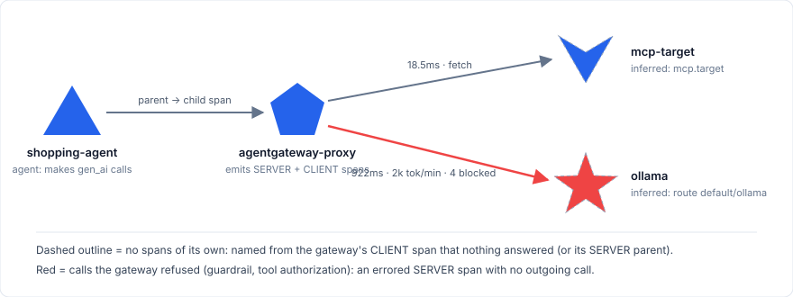
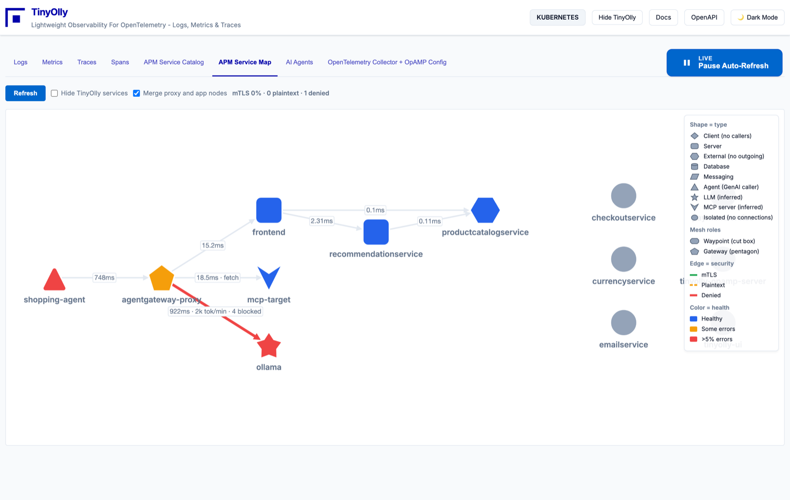

# Technical Details

## Architecture

  

## Data and OTLP

- **Ingestion:** OTLP/gRPC (primary) and OTLP/HTTP. The OpenTelemetry Collector's config is managed over OpAMP.
- **Storage:** traces, logs and metrics in full OpenTelemetry format (resources, scopes, attributes) in embedded SQLite, compressed with ZSTD and msgpack, in WAL mode so reads continue during writes.
- **Retention:** records expire after 30 minutes (`SQLITE_TTL_SECONDS`) and the database is capped at 256 MB (`MAX_DB_SIZE_MB`, oldest evicted first). Data survives restarts until it expires.
- **Correlation:** traces, spans, logs and metrics linked by trace and span IDs; [cardinality protection](CARDINALITY-PROTECTION.md) stops metric explosions.
- **REST API:** OpenTelemetry-formatted JSON ([REST API](api.md)).

## UI features

- **Trace waterfall** with noisy ASGI sub-spans (http send/receive) filtered out, and a per-trace service graph above it; inferred external clients come from orphan parent span IDs.
- **Deep links:** `?tab=traces&traceId=...`, `?tab=spans&spanId=...`, `?tab=logs&search=...`; "Copy Link" buttons generate them, and IDs copy with one click.
- **Correlated logs** inline in a trace; trace and span IDs in logs jump to their trace or span.
- **Service Catalog:** RED metrics; a service name opens a menu (map, traces, spans, logs, metrics) filtered to it.
- **Service Map:** Cytoscape.js and dagre, left to right, always fitted to the window. Shape and fill colour are the node type (server, client, external, database, messaging, isolated, and [agent, LLM, MCP server](#agents-llms-and-mcp-servers)); the outline is health (solid yellow some errors, solid red over 5%) or marks an inferred node that sends no spans (dashed grey); TinyOlly's own services can be hidden. With Istio, edges also come from mesh metrics (green mTLS, orange dashed plaintext, red denied), with waypoint and gateway shapes ([Istio Ambient Mesh](istio.md)). A selected node shows P50/P95/P99 and rate.
- **Auto-refresh** every 5 s, paused while a search filter is active; lists scroll with sticky headers.

## Agents, LLMs and MCP servers

An LLM such as Ollama and most MCP servers emit no spans, so the call into them is a CLIENT span that nothing answers and the hop would vanish from the map. TinyOlly infers the callee, as it does for databases (`tinyolly_common/graph_infer.py`):

- **LLM** (star): an unanswered call marked `agentgateway.outbound.subtype=Llm`, or carrying `gen_ai.request.model` on it or its parent. Named after the gateway route's backend (`default/ollama` → `ollama`), else `gen_ai.provider.name`, else the host. The edge carries input and output tokens, models and endpoints; the label shows tokens per minute.
- **MCP server** (chevron): `subtype=Mcp` or `mcp.target`. The edge counts calls per method and per tool (`gen_ai.tool.name`); the label shows the busiest tool.
- **Agent** (triangle): a service that makes GenAI calls (a CLIENT span with `gen_ai.operation.name`, or `gen_ai.agent.name`). Gateways carry `gen_ai.*` on their SERVER spans, so they stay gateways.
- **Blocked at the gateway** (red edge): a refused call (prompt guard, tool authorization) is an errored SERVER span with `protocol` llm/mcp, a `reason` such as `Guardrail` or `Authorization`, and no outgoing call. It is drawn to the node it was meant for and counted in `blocked`; the node's colour includes it.
- **Any other uninstrumented upstream:** named by `peer.service`, the gRPC `rpc.service`, or the host (a Kubernetes Service name for `*.svc.*` hosts), unless that is a known service. A call made to an IP is named by reverse DNS, which in Kubernetes gives the Service (`10.96.135.219` → `cartservice`; cached 10 minutes, `SERVICE_MAP_RESOLVE_IPS=0` turns it off); IPs without a name and telemetry exports are skipped. `SERVICE_MAP_INFER_EXTERNAL=0` turns this rule off.

Inferred nodes have a dashed outline in the UI and in the MCP charts.

Trace detail (`/api/traces/{id}`) marks those spans with `inferredPeer`, so `chart_trace_path` shows the hop too. Built and checked on an agentgateway demo (a shopping agent calling Qwen on Ollama and an MCP fetch tool through agentgateway):

## MCP server

`docker/apps/tinyolly-mcp` is a read-only MCP server over the REST API: telemetry queries, these docs (`list_docs`, `search_docs`, `read_doc`), tables, waterfalls and PNG charts, Istio mesh tools, and investigation playbooks served as tools, prompts and resources. Responses are size-bounded; large traces are summarized and paged. It runs as a stdio process started by the client or as the `tinyolly-mcp` container (streamable HTTP on 8765). See the [MCP guide](mcp.md).

The opt-in [TinyOlly AI SRE Agent](ai-sre.md) uses these tools to investigate incidents on its own.

## Testing

Everything runs locally (no CI): `./scripts/test-all.sh` runs the unit suites (storage library, UI/API, OTLP receiver, MCP server, frontend JS, OpAMP Go server, collector configs, kubectl guard); `--stack` adds the end-to-end run against the live stack (88 checks including every collector preset) and `--kind` a kind smoke test. See the [development notes](development.md).
