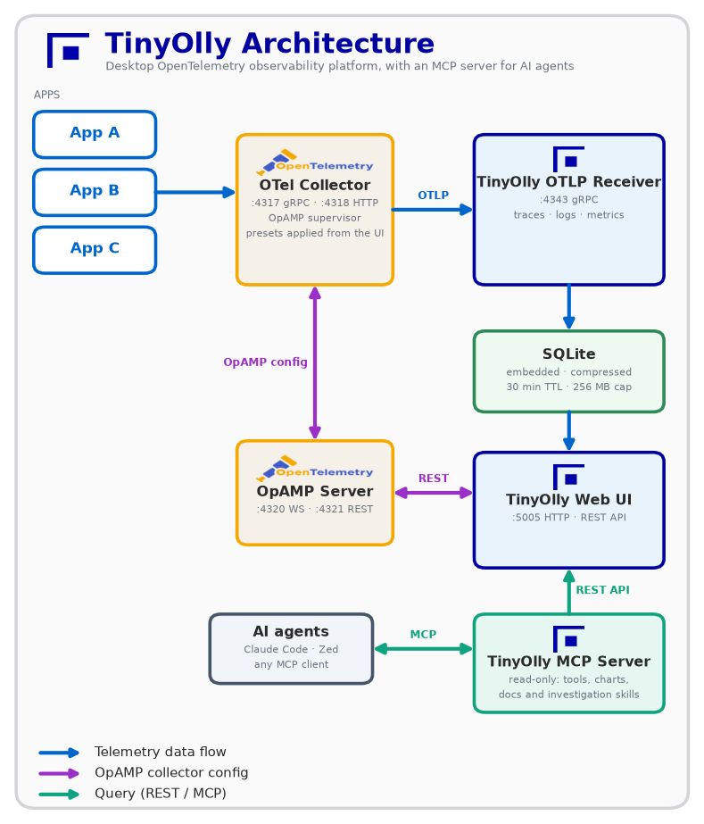

# Technical Details

## Architecture

  

## Data and OTLP

- **Ingestion:** OTLP/gRPC (primary) and OTLP/HTTP. The OpenTelemetry Collector's config is managed over OpAMP.
- **Storage:** traces, logs and metrics in full OpenTelemetry format (resources, scopes, attributes) in embedded SQLite, compressed with ZSTD and msgpack, in WAL mode so reads continue during writes.
- **Retention:** records expire after 30 minutes (`SQLITE_TTL_SECONDS`) and the database is capped at 256 MB (`MAX_DB_SIZE_MB`, oldest evicted first). Data survives restarts until it expires.
- **Correlation:** traces, spans, logs and metrics linked by trace and span IDs; [cardinality protection](CARDINALITY-PROTECTION.md) stops metric explosions.
- **REST API:** OpenTelemetry-formatted JSON ([REST API](api.md)).

## UI features

- **Trace waterfall** with noisy ASGI sub-spans (http send/receive) filtered out, and a per-trace service graph above it; inferred external clients come from orphan parent span IDs.
- **Deep links:** `?tab=traces&traceId=...`, `?tab=spans&spanId=...`, `?tab=logs&search=...`; "Copy Link" buttons generate them, and IDs copy with one click.
- **Correlated logs** inline in a trace; trace and span IDs in logs jump to their trace or span.
- **Service Catalog:** RED metrics; a service name opens a menu (map, traces, spans, logs, metrics) filtered to it.
- **Service Map:** Cytoscape.js and dagre, left to right, always fitted to the window. Shape is the service type (server, client, external, database, messaging, isolated), colour the health (blue, amber some errors, red >5%); TinyOlly's own services can be hidden. With Istio, edges also come from mesh metrics (green mTLS, orange dashed plaintext, red denied), with waypoint and gateway shapes ([Istio Ambient Mesh](istio.md)). A selected node shows P50/P95/P99 and rate.
- **Auto-refresh** every 5 s, paused while a search filter is active; lists scroll with sticky headers.

## MCP server

`docker/apps/tinyolly-mcp` is a read-only MCP server over the REST API: telemetry queries, these docs (`list_docs`, `search_docs`, `read_doc`), tables, waterfalls and PNG charts, Istio mesh tools, and investigation playbooks served as tools, prompts and resources. Responses are size-bounded; large traces are summarized and paged. It runs as a stdio process started by the client or as the `tinyolly-mcp` container (streamable HTTP on 8765). See the [MCP guide](mcp.md).

The opt-in [TinyOlly AI SRE Agent](ai-sre.md) uses these tools to investigate incidents on its own.

## Testing

Everything runs locally (no CI): `./scripts/test-all.sh` runs the unit suites (storage library, UI/API, OTLP receiver, MCP server, frontend JS, OpAMP Go server, collector configs, kubectl guard); `--stack` adds the end-to-end run against the live stack (88 checks including every collector preset) and `--kind` a kind smoke test. See the [development notes](development.md).
