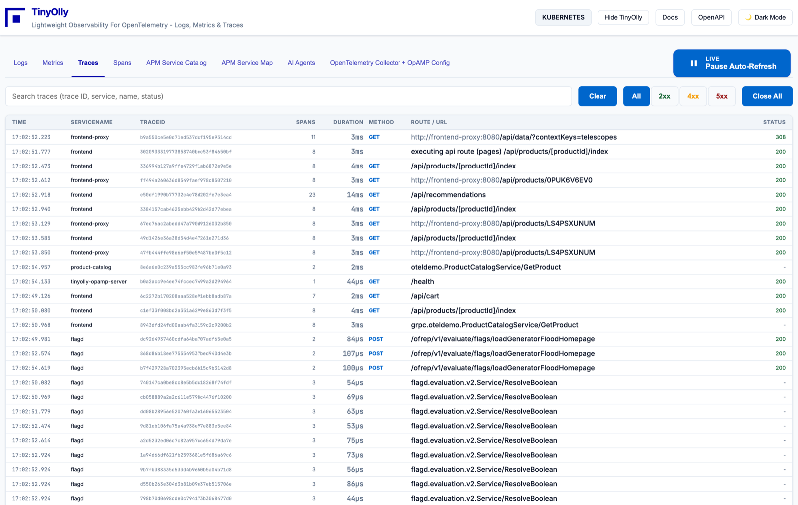
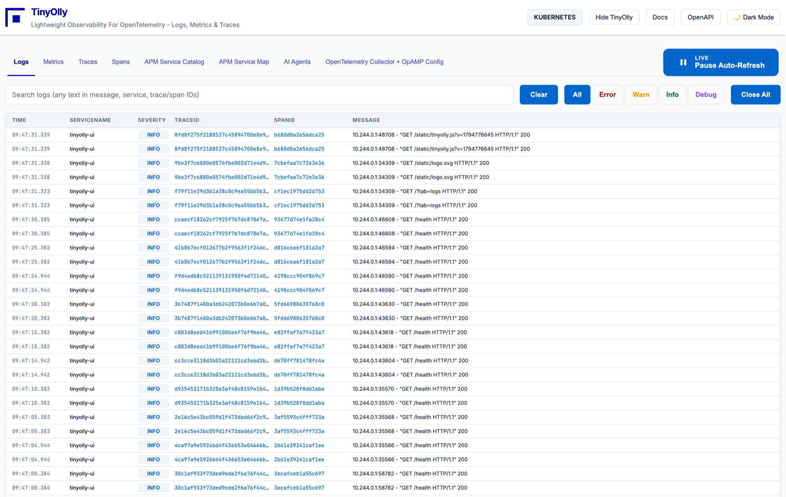
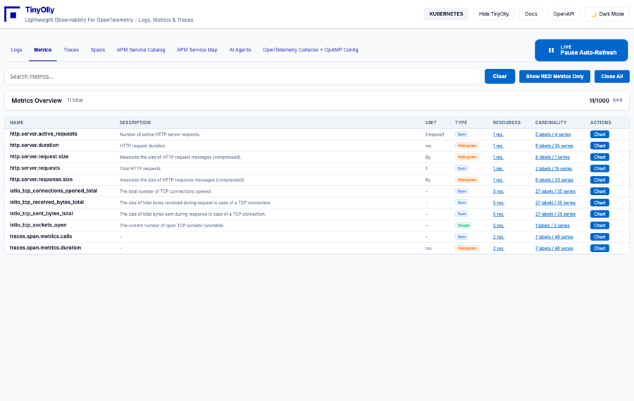
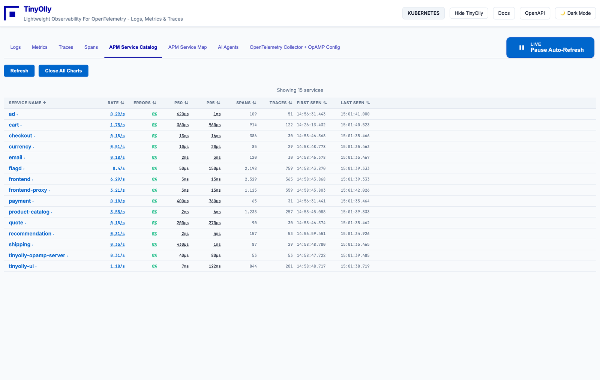
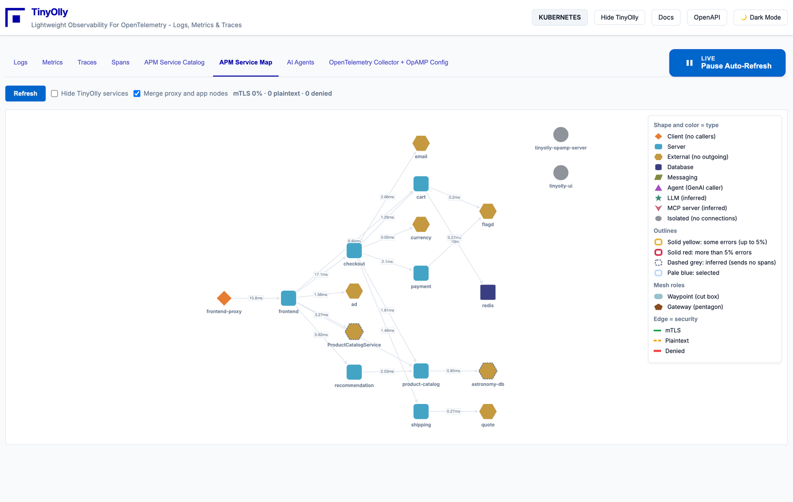
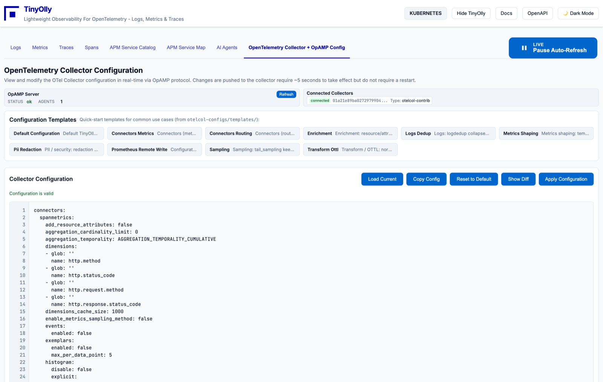

# UI Tour

Open `http://localhost:5005`.

**Traces:** each trace's span waterfall with its correlated logs; click a span for its full JSON.

  

**Logs:** linked to their trace and span, filterable by severity.

  

**Metrics:** every metric with charts and cardinality.

  

**Service Catalog:** rate, errors and duration per service; click a name to jump to its map node, traces, spans, logs or metrics.

  

**Service Map:** dependencies with shape for service type and colour for health (legend above the map); click a node for latency.

  

**OpenTelemetry Collector + OpAMP Config:** view a connected collector's config, apply changes with validation and a diff preview, or apply a [collector preset](collector-presets.md) (sampling, PII redaction, transforms, connectors and more). The collector needs the OpAMP extension (see [OpAMP configuration](otel-collector.md#opamp-configuration-optional)).

  

